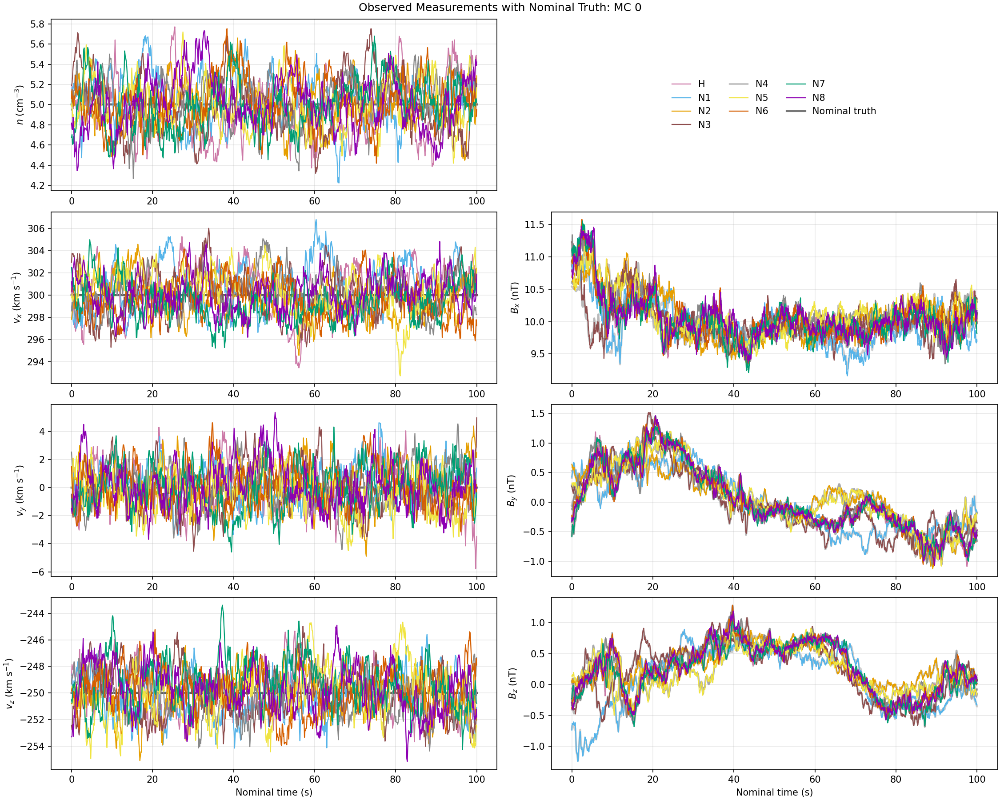
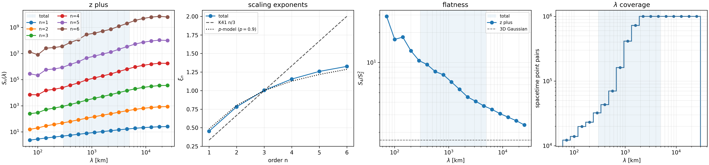

# HelioSwarm Integrated Virtual Explorer (HIVE)

[](https://doi.org/10.5281/zenodo.23423894)

**HIVE (HelioSwarm Integrated Virtual Explorer)** is an open-source Python framework for simulating and analyzing multipoint synthetic plasma measurements from representative configurations of NASA's future HelioSwarm mission.

By sampling prescribed plasma fields along representative trajectories of HelioSwarm's nine spacecraft, HIVE enables researchers to investigate how spacecraft geometry, instrument resolution, and measurement uncertainties affect the recovery of physical quantities.

HIVE provides a configurable environment for developing and validating multipoint analysis techniques, including turbulence statistics, spatial gradients, and shock characterization, before applying them to mission observations.

*Some generation and analysis methods are currently under development. We encourage interested members of the community to contribute additional methods.*

## HIVE in Action

HIVE provides a configurable framework for generating synthetic HelioSwarm observations
and evaluating those observations with multipoint analysis techniques.

### Virtual spacecraft configurations


Representative positions of the nine HelioSwarm spacecraft, consisting of a hub and eight nodes.
HIVE uses these configurations to investigate how spacecraft separations and geometries affect multipoint measurements.
The current representative trajectories for HelioSwarm are available [here](https://doi.org/10.5281/zenodo.13887061).

See [configuration and generation](docs/user-guide/generation.md).
[Explore animations of the HelioSwarm spacecraft configurations](docs/user-guide/movies.md).

### Synthetic multipoint observations



An example of synthetic measurements of plasma density, velocity, and magnetic field sampled
along nine spacecraft trajectories through a prescribed turbulent field.
HIVE supports configurable measurement cadences and uncertainties,
allowing researchers to quantify the effects of instrument and observatory performance on the resulting measurements.

See [generation](docs/user-guide/generation.md) and
[measurement errors](docs/reference/errors.md).

### Turbulence statistics and intermittency



Example analysis of a prescribed turbulent field, showing structure functions, scaling exponents, flatness, and available spacetime pair counts.
These reference statistics provide a benchmark against which the recovery of turbulence properties from synthetic spacecraft observations can be evaluated.

See [statistical methods](docs/reference/statistical-methods.md)
and [intermittency research](docs/research-notes/intermittency-recovery.md).

## Installation

HIVE requires **Python 3.10 or newer**. To install HIVE, clone the repository and create a Python virtual environment:

```bash
git clone https://github.com/kgklein/hs-observatory.git
cd hs-observatory

python3 -m venv .venv
source .venv/bin/activate
python -m pip install -e .
```

This installs HIVE and its required dependencies in editable mode, allowing changes to the source code without reinstalling the package.

For alternative installation methods, optional dependencies, and external data requirements, see the [installation guide](docs/getting-started/installation.md).
These instructions use a Unix-compatible shell (Linux or macOS).
HIVE is developed and tested on Linux; Windows users are encouraged to use the Windows Subsystem for Linux (WSL).

## Quick Start

HIVE uses YAML configuration files to specify spacecraft trajectories, plasma fields, measurement uncertainties, and analysis methods.

**Spacecraft trajectories:** Download the representative HelioSwarm spacecraft position CDF files from the [HelioSwarm trajectory archive (Zenodo)](https://doi.org/10.5281/zenodo.13887061).
Update `cdf_directory` in `configs/example_generate.yaml` to point to the downloaded files.

After installation, run the example from the repository root:

```bash
hsobs-generate configs/example_generate.yaml
hsobs-analyze configs/example_analyze.yaml
```

The example generates five minutes of synthetic plasma measurements, including ten Monte Carlo realizations with configurable measurement uncertainties.

Results are saved in `outputs/example/`, including synthetic observations (HDF5), diagnostic figures (PNG), and an analysis summary (JSON).

See the [Quick Start guide](docs/getting-started/quick-start.md) for additional details about configuration, output products, and the Python API.

## Documentation

Full documentation is available on the [HIVE documentation website](https://kgklein.github.io/hs-observatory/).

Follow the researcher workflow:

1. [Install HIVE](docs/getting-started/installation.md) and run the [quick start](docs/getting-started/quick-start.md).
2. [Generate synthetic observations](docs/user-guide/generation.md).
3. [Analyze data](docs/user-guide/analysis.md).
4. [Visualize and interpret](docs/user-guide/visualization.md).

Additional documentation covers the underlying [scientific methods](docs/reference/statistical-methods.md), [research notes](docs/research-notes/index.md), and [software architecture](docs/architecture/index.md).

Interested contributors can consult the [developer guide](docs/developer/index.md).

## Citation, contributions and license

Please use [CITATION.cff](CITATION.cff) and cite the scientific methods used in your analysis.
See [CONTRIBUTING.md](CONTRIBUTING.md) for contributions and issue reports.
The software is distributed under the [MIT license](LICENSE).
