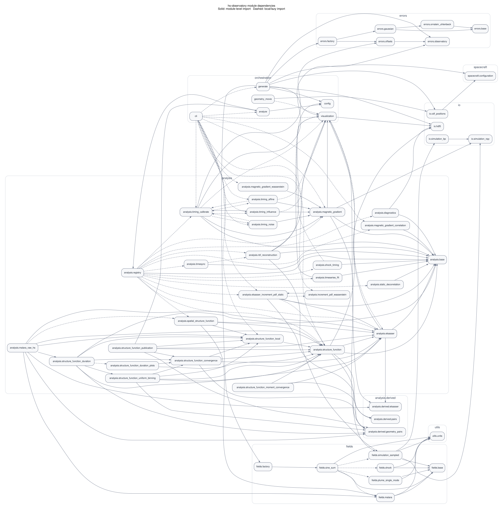

# Architecture diagrams

The [site overview](index.md) embeds `package-overview.svg`: a curated, generated
view of 13 architectural areas. The [module page](module-dependencies.md) embeds
the detailed graph below. This README retains the developer extraction notes;
MkDocs uses `index.md` as this directory's landing page.

The overview uses explicit `overview_group` and `OVERVIEW_RELATIONSHIPS` rules
in the generator. Each displayed relationship must have an AST import witness;
removing all witnesses removes the edge. Node/edge SVG tooltips show members and
witnesses. Secondary CLI plotting paths, cross-family helper/validation edges,
and low-level utilities are intentionally omitted from this newcomer view.
All overview arrows represent selected dependencies, not execution order or
HDF5 product flow. The detailed view retains its existing edge semantics.

## Detailed module graph

[Open the SVG](module-dependencies.svg) for a zoomable view.



Each node represents a Python module under `src/hs_observatory`. An arrow
`A -> B` means A imports B. Labels omit the `hs_observatory.` prefix, and
clusters group modules by responsibility/package.

- **Solid arrows:** imports outside functions or methods, including class-body
  imports. Conditional module-level imports remain solid.
- **Dashed arrows:** imports inside functions or methods, including lazy imports.
- If both kinds occur for the same pair, the arrow is solid.
- `TYPE_CHECKING`-only branches are excluded; runtime `else` branches are included.

The default view omits tests, standalone scripts/helpers, thin `cli_*.py`
wrappers, package initializer nodes and their re-export edges, analysis imports
of `register_analysis`, and package-version metadata imports. Other dependencies
and cycles remain visible. `analysis.registry` still points to the built-in
analyses it loads lazily.

## Regeneration

From the repository root, using Python 3.10 or newer:

```bash
python scripts/generate_architecture_graph.py
```

Use `python3` if your environment does not provide `python`. No installation of
the project or third-party Python packages is needed. The script writes both
`module-dependencies.dot` and `package-overview.dot` here and renders their SVGs when the
Graphviz `dot` executable is on PATH. Missing Graphviz does not prevent DOT
generation. Default paths are anchored to the repository, so invocation from
another working directory also works.

```bash
# DOT only; an existing SVG is left unchanged.
python scripts/generate_architecture_graph.py --no-render

# Include initializers/re-exports, wrappers, registration and version edges.
python scripts/generate_architecture_graph.py --full \
  --dot /tmp/hsobs-full.dot --svg /tmp/hsobs-full.svg

# Omit function-local imports; use --show-local-imports to explicitly show them.
python scripts/generate_architecture_graph.py --hide-local-imports \
  --dot /tmp/hsobs-global.dot --svg /tmp/hsobs-global.svg
```

Explicit output paths are relative to the current working directory. Overview
files are placed alongside the respective `--dot` and `--svg` paths using the
fixed names `package-overview.dot` and `package-overview.svg`. Use
`--detailed-only` to preserve the original single-graph output mode. `--full`
affects only the detailed graph; `--hide-local-imports` affects both views.
The script
prints node/edge counts, every suppressed dependency and its reason, and rendering
status. Commit regenerated DOT and SVG together when updating this view.

## Interpretation and limitations

This is a **static source dependency graph**, not a runtime execution graph or a
scientific workflow diagram. Extraction uses only standard-library `ast` parsing;
it never imports or executes the analyzed package. The only subprocess is the
optional Graphviz renderer.

Relative imports are resolved against the source package. For
`from package import name`, an existing source submodule takes precedence;
otherwise the dependency points to the module providing the imported symbol.
Package initializer nodes use their package import name internally and an
`.__init__` display label in the full view. Re-exported symbols are not traced
transitively through initializers. The default view omits dependencies involving
those initializer nodes. Wildcard and unresolved first-party imports produce
warnings.

The graph does not add implicit parent-package initialization edges, infer dynamic
imports, resolve monkey-patching, or represent data flow through HDF5 files.
Except for recognized `TYPE_CHECKING` guards (including aliases, `not`, `and`,
and `or`), conditional branches are conservatively included. Unusual rebinding of
typing aliases cannot be resolved reliably from this lightweight analysis.

Node and edge ordering in DOT is deterministic. SVG layout can vary with the
Graphviz version and installed fonts. The white background and restrained styling
support browser viewing and vector printing; use landscape/large-format output
or crop a cluster when a full-page reduction makes labels too small.
