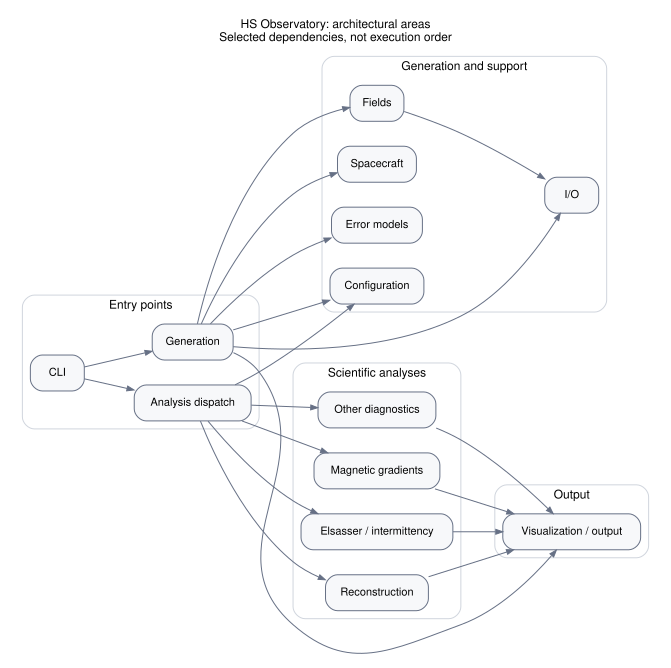

# Architecture Overview

HS Observatory separates physical field models, spacecraft sampling, instrument
errors, storage, and analysis. Its main user-facing stages are generation of an
observation HDF5 product and analysis of that saved product.

## Architectural areas

[Open the overview SVG](package-overview.svg) to zoom in.



This generated overview groups source modules into responsibilities and shows
selected dependencies supported by the AST import graph. It deliberately omits
secondary plotting entry points, low-level utilities, internal family edges, and
shared validation/helper dependencies. Node and arrow tooltips in the standalone
SVG identify member modules and the source imports supporting each arrow.

**The arrows are not an execution sequence.** A conceptual workflow also includes
configuration choices and data moving through saved HDF5 products, which need
not create Python import edges. For the complete default static view, see
[Module Dependencies](module-dependencies.md).

## Responsibilities

**Orchestration and CLI.** `cli` provides installed commands; `config` loads and
validates YAML. `generate` and `analyze` coordinate the two principal stages.

**Generation.** The generator constructs time grids, samples nominal and perturbed
coordinates, applies measurement errors, and writes observations. Its workflow
is described in [Generating Synthetic Observations](../user-guide/generation.md).

**Fields.** `fields` supplies the common evaluation interface and configurable
analytic, turbulence, PLUME, and simulation-sampling implementations.

**Spacecraft and configuration.** `spacecraft.configuration` represents spacecraft
positions and velocities. CDF loading and synthetic fallback connect these
geometries to the measurement time grids.

**Error models.** `errors` contains coordinate-offset models, Gaussian and
Ornstein–Uhlenbeck measurement errors, and the observatory requirement model.
Sampling perturbations and measurement errors have distinct roles.

**I/O.** `io` reads trajectory/simulation inputs and reads or writes observation
HDF5 products. Analysis-specific modules also manage their own derived products.

**Analysis dispatch.** `analyze` selects a class through `analysis.registry`.
Registered classes implement the `AnalysisMethod` interface and handle execution
and output for their method.

**Scientific analyses.** Shared Elsasser and pair utilities support intermittency
analyses; other families cover magnetic gradients, reconstruction, and spectral
or spatial diagnostics. The [Analysis Methods](../analysis_methods.md) page
documents the available methods.

**Visualization and output.** The package visualization module supplies common
time-series and geometry figures. Scientific modules also contain specialized
plots and product writers. Standalone helpers in the repository's `visualization/`
directory inspect reconstruction products and export them to ParaView; those
helpers are outside the package-only graph.

## Updating the diagrams

From the repository root:

```bash
python3 scripts/generate_architecture_graph.py
```

The script emits both DOT files and, when Graphviz `dot` is available, both SVGs.
See [Documentation Development](../developer/documentation.md) for build commands.
