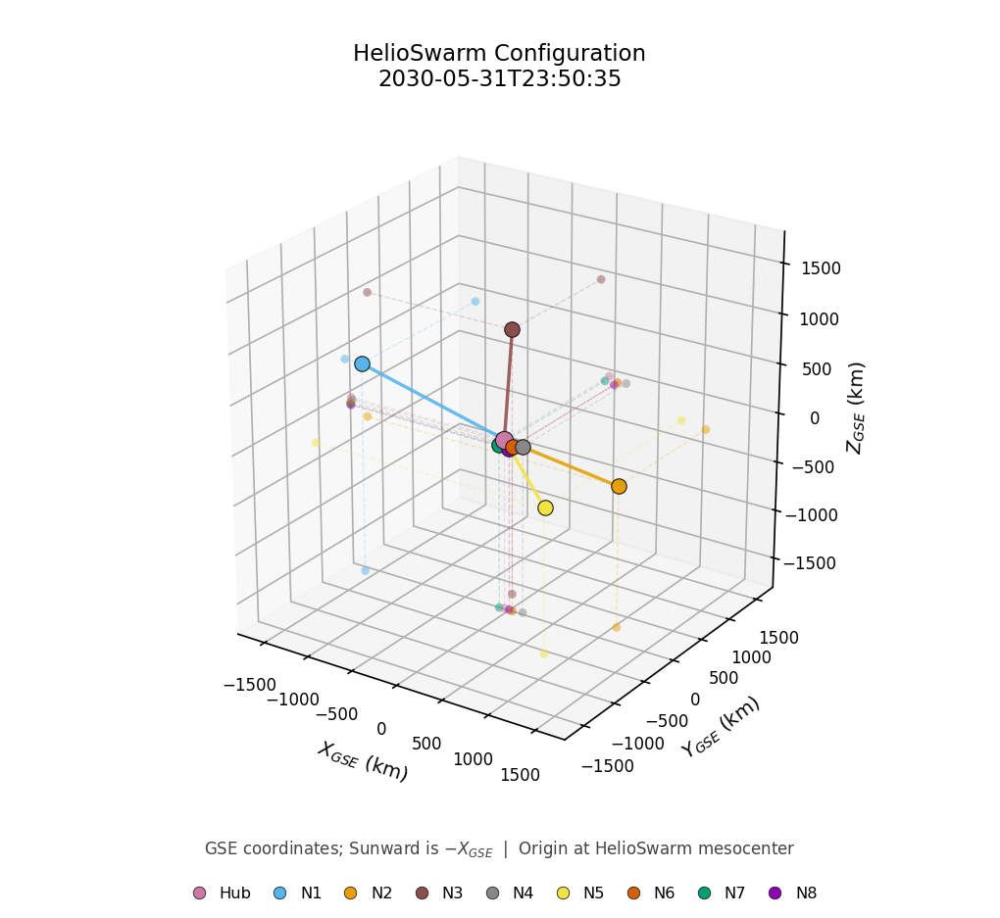
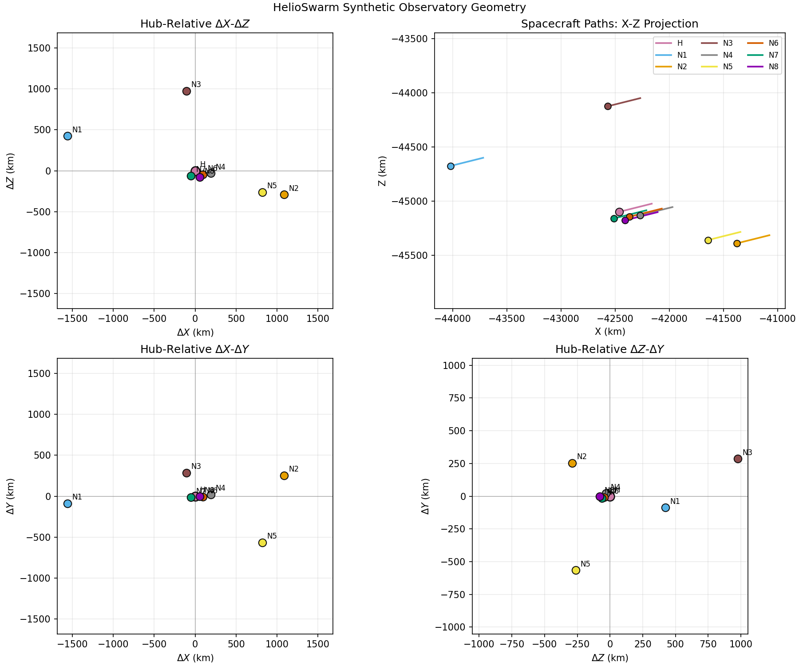
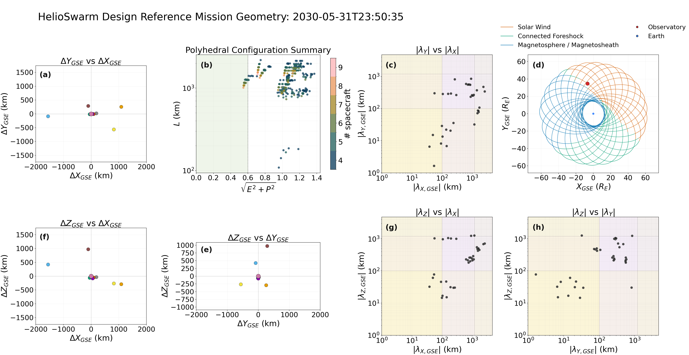
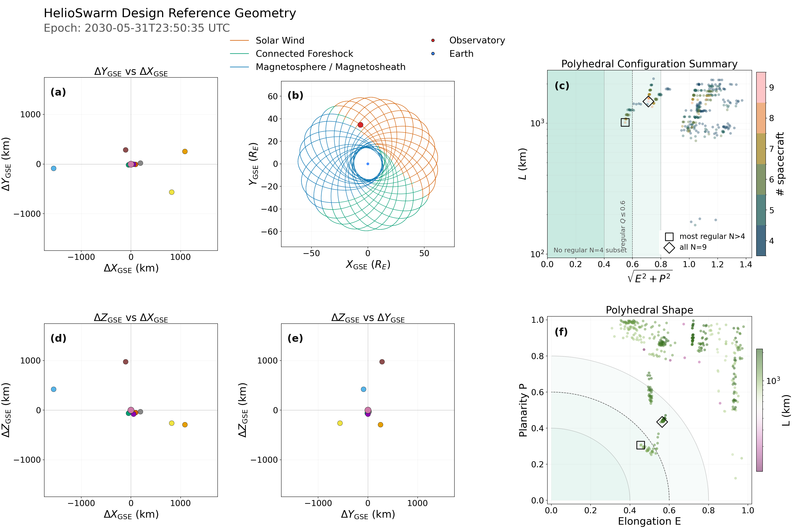
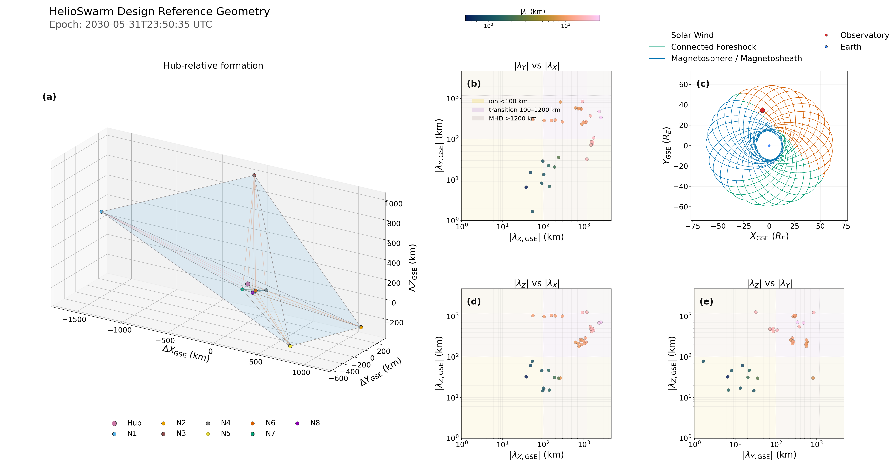
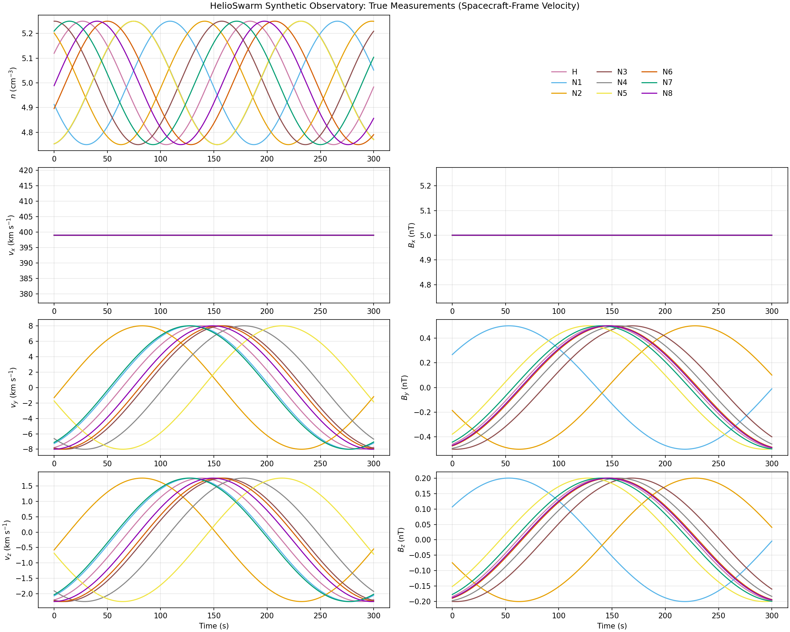
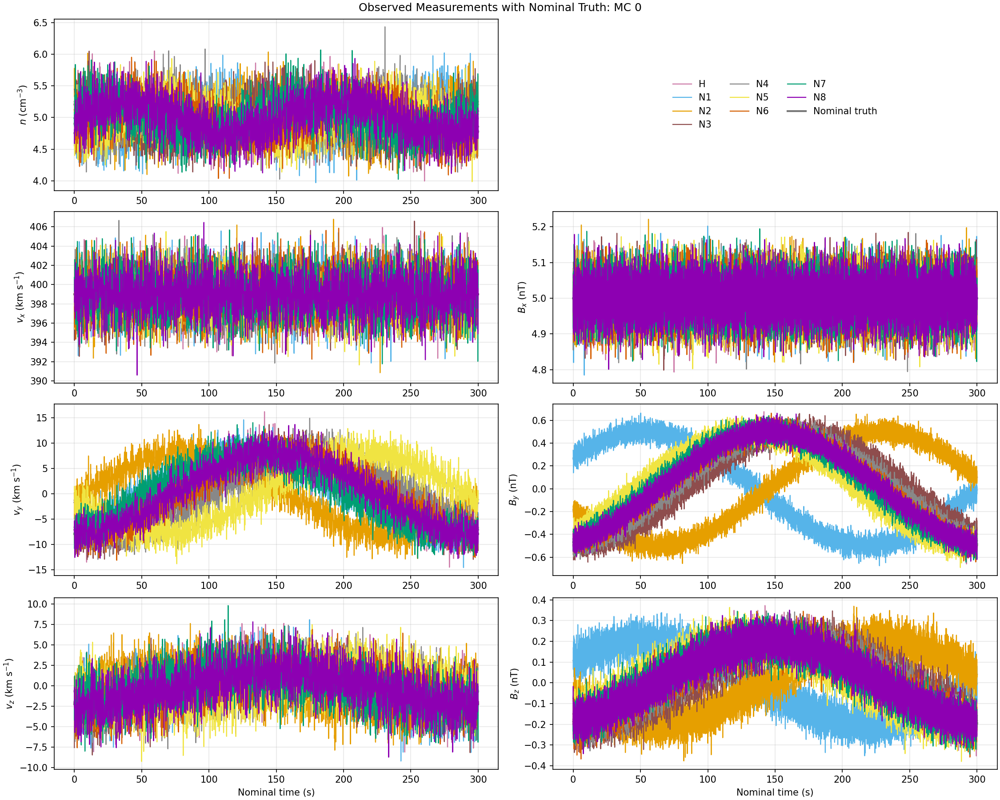

# First Light

After completing the [installation](installation.md),
activate the environment and run commands from the repository root,
enabling relative configuration and output paths to resolve as expected.

## Generating Example Observations

For our first calculation, we will generate a time series.

```bash
hsobs-generate configs/example_generate.yaml
```

The script expects a CDF file for the positions of the nine HS spacecraft, covering June 1, 2030.
In the `spacecraft:` namelist in `example_generate.yaml`, ensure that `cdf_directory` points to the directory where you have stored the [representative trajectories](https://doi.org/10.5281/zenodo.13887061).

This first example uses a sum of sine wave for the underlying field,
with expected measurement cadences for n,V, and B.
We include Gaussian measurement errors for position, time, and plasma quantites,
with ten Monte Carlo realizations.
It requests CDF spacecraft geometry.
Enabling `fallback_synthetic: true`, will allow it to run without mission files for arbitrarily selected relative positions.

The configured products include:

- `outputs/example/synthetic_observations.h5`: true measurements, observed measurements, coordinates,
  errors, and generation metadata.
- Truth and observed time-series/geometry PNGs under `outputs/example/`.

### Figures from Example Data Generation

The following figures are constructed when new observations are generated.

**Configurations**



*Single Panel Summary of HelioSwarm Configuration*



*HelioSwarm Configuration for Example Data Generation.*



*HelioSwarm Configuration Geometry Overview*



*HelioSwarm Configuration Polyhedral Geometry Summary*



*HelioSwarm Configuration Spacecraft Separation Geometry Summary*

**Measurements**



*HelioSwarm **True** Observations for Example Data Generation*



*HelioSwarm Observations **with measurement error** for Example Data Generation*

Read [Generating Synthetic Observations](../user-guide/generation.md) to change
field or sampling choices, and the [Observatory Error Model](../reference/errors.md)
for the requirement-driven error path.