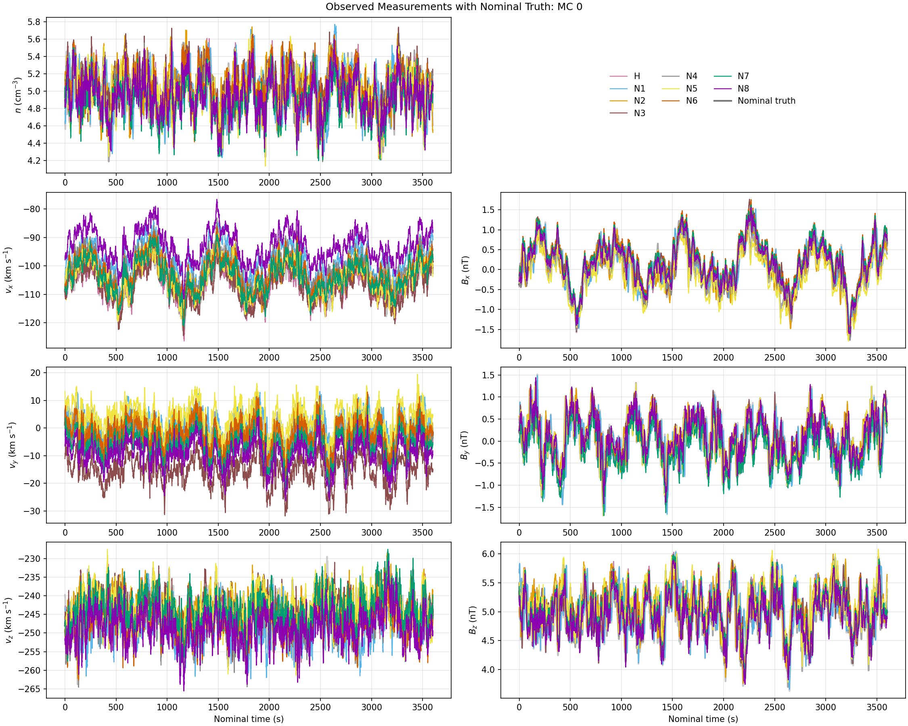
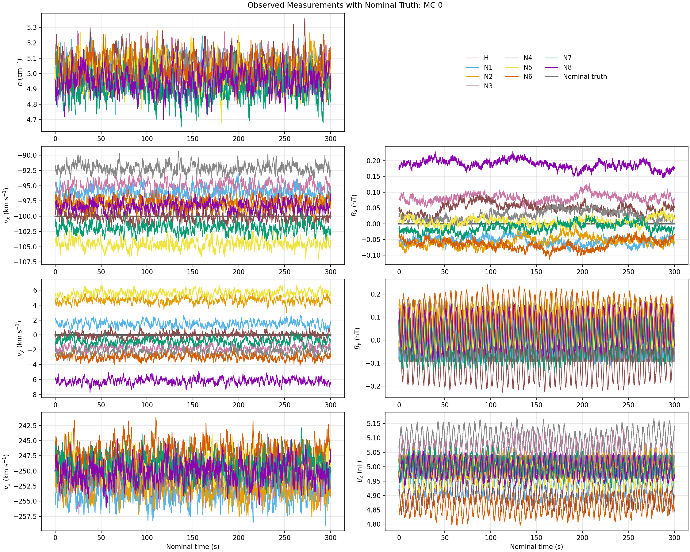
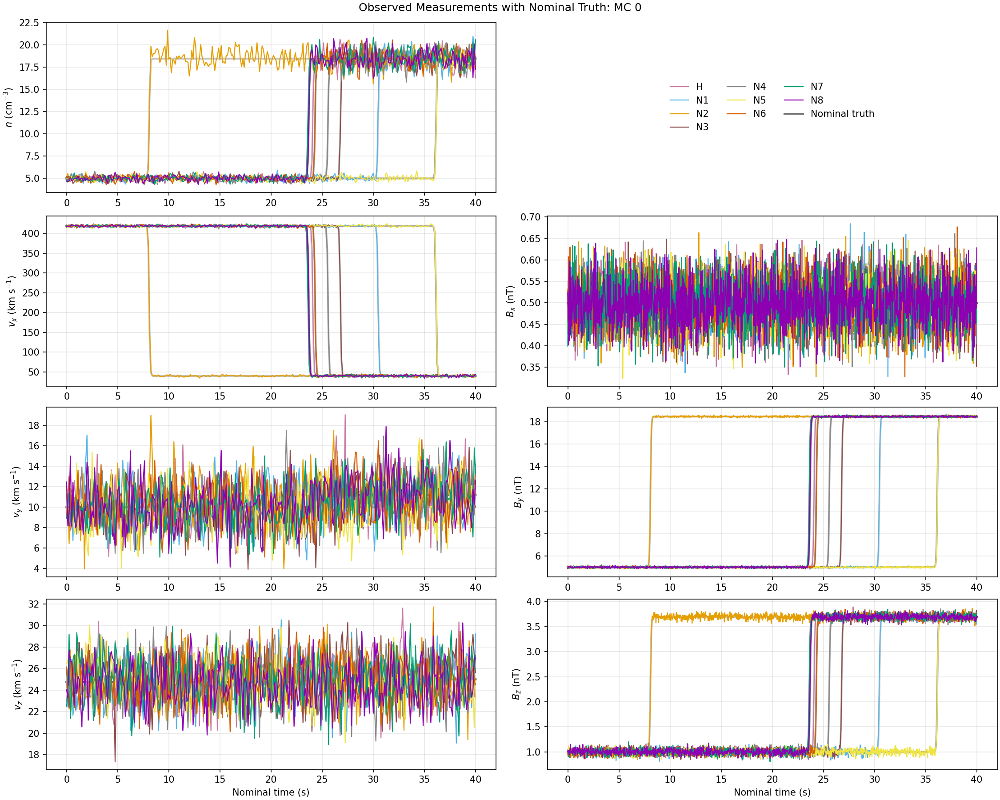

# Physical fields and simulation sampling

| Summary | Details |
| --- | --- |
| Purpose | Define the physical n, v and B sampled by the observatory. |
| Required inputs | Generation YAML; PLUME or simulation files if using those models. |
| Entry points | `hsobs-generate CONFIG`; `field.model`. |
| Outputs | Truth fields and field metadata in observation HDF5. |
| Limitations | Model assumptions; external inputs are not bundled. |

See the [visualization guide](../user-guide/visualization.md) for inspection and plotting.

## Sine-sum field

The simplest example configuration uses `field.model: sine_sum`.
Each mode selects `quantity` (`n`, `v`, or `B`),
an amplitude,
wave vector `k`,
angular frequency `omega`,
and phase.
Scalar density and vector velocity/magnetic modes are added to `field.background`.
Positions are in km and time in seconds;
`k` is in inverse km and `omega` in rad/s.
See `configs/example_generate.yaml` and `fields.sine_sum.SineSumField`.
*This is a toy model that does not satisfy plasma dispersion relations or conservation laws.*

```yaml
field:
  model: sine_sum
  background:
    n: 5.0
    v: [400.0, 0.0, 0.0]
    B: [5.0, 0.0, 0.0]
  modes:
    - quantity: n
      amplitude: 0.25
      k: [0.01, 0.0, 0.0]
      omega: 0.05
      phase: 0.0
    - quantity: v
      amplitude: [0.0, 8.0, 2.0]
      k: [0.004, 0.003, 0.0]
      omega: 0.025
      phase: 0.5
    - quantity: B
      amplitude: [0.0, 0.5, 0.2]
      k: [0.001, 0.002, 0.0]
      omega: 0.02
      phase: 0.0
```

## p-model Intermittent Turbulence

`fields/malara.py` provides a low-level isotropic evaluator for a p-model of turbulence inspired by Malara et al., [“Fast algorithm for a three-dimensional synthetic model of intermittent turbulence”](https://doi.org/10.1103/PhysRevE.94.053109).
`MalaraTurbulence.evaluate_vector(positions)` evaluates a deterministic three-component turbulent field directly at arbitrary points without constructing a spatial grid.

The current evaluator is time-independent, periodic in three dimensions,
intermittent through a deterministic p-model cascade,
and solenoidal by construction from the curl of compact vector-potential eddies.
At each dyadic scale it evaluates only the neighboring eddies whose overlapping supports contain the point.
*Anisotropic and critically-balanced variants are future extensions.*

`field.model: malara_turbulence` connects it to generated observations.
*Density remains constant* with magnetic and velocity fluctuations rendered as scaled copies of a p-model realization.
With no input offset, `v` and `B` share the same vector field.
Set `realization_offset` to select an independent realization.
The adapter defaults the low-level vector-potential amplitude to the characteristic domain length,
and ensures the output-field amplitudes are in the desired physical units.
An explicit `turbulence.amplitude` overrides this normalization.

```python
from hs_observatory.fields.malara import MalaraConfig, MalaraTurbulence

model = MalaraTurbulence(MalaraConfig(n_scales=6, realization=1))
u = model.evaluate_vector(positions)  # positions and u both end in dimension 3
```

Run the integrated example with:

```bash
hsobs-generate configs/example_generate_malara.yaml
```

```yaml
field:
  model: malara_turbulence
  domain:
    L: [100000.0, 100000.0, 100000.0]
    units: km
    origin: [0.0, 0.0, 0.0]
  turbulence:
    geometry: isotropic
    backend: cached
    chunk_size: 1000
    n_workers: null
    n_scales: 8
    injection_scale_index: 2
    intermittency_p: 0.7
    base_seed: 12345
    realization: 1
  output_fields:
    n: {background: 5.0, fluctuation: constant}
    v:
      background: [400.0, 0.0, 0.0]
      fluctuation: none
      amplitude: 0.0
    B:
      background: [5.0, 0.0, 0.0]
      fluctuation: malara
      amplitude: 0.5
```


*HelioSwarm Observation of P-Model Turbulence*

*Density turbulence is unsupported for now.* Set `n.fluctuation: constant` to fill density with `n.background`; the legacy `none` remains accepted.
**This leaves a clean extension point for a future density model.**

### Malara evaluator performance

Although the evaluator visits only nearby eddies, reconstructing deterministic random parameters and walking each p-model ancestry creates substantial Python overhead.
Four backends provide choices for optimizing this calculation without changing the field mathematics:

- `direct` is the uncached scientific reference.
- `chunked` applies the reference evaluator serially to bounded position chunks.
- `cached` lazily retains random eddy parameters, heritage patterns, p-model transfer factors, and final amplitudes only for touched eddies. This is the default for generated Malara fields.
- `parallel` evaluates ordered chunks in worker processes, optionally with a private cache in each worker. No mutable cache is shared between processes.

Select the generation backend under `field.turbulence`:

```yaml
turbulence:
  backend: cached       # direct, chunked, cached, or parallel
  chunk_size: 1000      # used by chunked and parallel
  n_workers: null       # parallel only; null uses the executor default
  use_cache: true       # parallel only
```

## Static Gkeyll simulation sampling

**This is intended as a first evaulation of a direct numerical simulation.
Interfaces for other simulations should be added.**

Use `field.model: simulation_sampled` to sample static uniform-grid `.npy` or
split Gkeyll `.bp` snapshots along the configured spacecraft positions.
*BP input requires the optional ADIOS2 dependency:*

```bash
python -m pip install -e '.[simulation-bp]'
```

These observations are generated via:

```bash
hsobs-generate configs/example_generate_simulation_sampled.yaml
```

The example matches the provider files, expected in `../gkeyll/data`.
It combines two packed ADIOS2 variables named `CartGridField`.
The field component order comes from the local loading note.
The ion component order is described there as
`n,nux,nuy,nuz,p`, but the Lua input uses Gkeyll Euler variables: component 0
is ion mass density `rho_i = n_i m_i`, and components 1,2,3 are momentum
density `rho_i u_i`.

```text
ot3D_field_75.bp: components 3,4,5 -> Bx,By,Bz
ot3D_ion_75.bp:   component 0    -> rho_i = n_i m_i
                  components 1,2,3 -> rho_i ux,rho_i uy,rho_i uz
u = (rho_i u) / rho_i
n_i = rho_i / m_i
```

The names, component indices, and whether the three ion components are
momentum density or already velocity are configurable under
`simulation.layout`.
The loader requests only those component slabs from
ADIOS2 and verifies that the field and moment grids match.

```yaml
simulation:
  format: bp
  sources:
    field: ../gkeyll/data/ot3D_field_75.bp
    moments: ../gkeyll/data/ot3D_ion_75.bp
  layout:
    field_variable: CartGridField
    moments_variable: CartGridField
    B_components: [3, 4, 5]
    density_component: 0
    density_representation: mass_density
    density_mass: 100.0
    momentum_components: [1, 2, 3]
    velocity_representation: momentum_density
```



*HelioSwarm Observation of Direct Numerical Turbulence Simulation*

For `.npy` input, the default snapshot layout is a combined fields-last array
`(nx, ny, nz, 7)` with components `[n, vx, vy, vz, Bx, By, Bz]`.

A fields-first `(7, nx, ny, nz)` array and different component indices are
supported through `simulation.layout`:

```yaml
simulation:
  layout:
    array_order: fields_last  # or fields_first
    variables:
      n: 0
      v: [1, 2, 3]
      B: [4, 5, 6]
```

The reference workflow's legacy magnetic-only `(nx, ny, nz, 3)` snapshots are
also supported by mapping only `B: [0, 1, 2]`.
Omitted fields must be marked `fluctuation`;
their zero fluctuation level produces the configured
background density or velocity.

The grid is uniform and endpoint-excluded: index `(i, j, k)` is located at
`(i Lx/nx, j Ly/ny, k Lz/nz)` in the periodic domain `[0,Lx) × [0,Ly) ×
[0,Lz)`.
Sampling uses NumPy trilinear interpolation and periodic indices.
The Hub is selected and mapped to the box center at the first sample.
Subsequent samples preserve the absolute motion of the complete formation:

```text
r_sim(t) = box_size/2 + (r_spacecraft(t) - r_hub(t_start))
r_wrapped = r_sim mod box_size
```

No rotation is applied. Translation of the entire formation is performed,
so a rigidly moving observatory traverses the static snapshot.

Coordinate lengths can be supplied directly in km, in generic code units, or
in the proton-gyroradius convention used by the reference simulation workflow:

```yaml
coordinates: {units: km, box_size_km: [100000, 100000, 100000]}
# or
coordinates: {units: code, box_size_code: [1, 1, 1], code_length_to_km: 100000}
# or
coordinates: {units: rho_p, box_size_rho_p: [64, 64, 64], rho_p_km: 100}
```

There is no universal conversion from simulation amplitudes to plasma units.
`scale_factors.n`, `.v`, and `.B` therefore explicitly convert selected
snapshot values to cm^-3, km/s, and nT. For the reference BP file, ion mass
density has mean 100 in code units because `ionMass = 100`; after
`density_representation: mass_density`, the code number density has mean 1.
The example then uses `scale_factors.n: 5`, giving a mean physical density of
5 cm^-3. The field guide value is `Bz = 0.2` in code units;
`scale_factors.B: 25` maps it to 5 nT. The matching velocity factor is about
2438 km/s per code velocity unit, so `U` and `B/sqrt(mu0 m_p n)` retain their
Alfvenic amplitude relation in physical units. A field marked `fluctuation`
receives the configured background after scaling; `total` uses the scaled
sample directly. The generated HDF5 field metadata records the source path and
shape, layout, physical box, mapping, boundary, interpolation, field semantics,
and scale factors.


A current limitations is time-stationarity; only one static snapshot state is used.
Future extensions may add time-dependent snapshots.

## PLUME single-mode plane wave

Instead of using arbitrary sine waves, this field uses eigenfunctions calculated by a linear plasma dispersion solver, [PLUME](https://kgklein.github.io/PLUME/).

`field.model: plume_single_mode` reads one explicitly selected numeric row from a whitespace-delimited PLUME `.mode` file and evaluates

```text
delta q(r,t) = Re[q_complex exp(i(k dot r - omega_r t + phase0))].
```
for density, velocity, and magnetic field fluctuations.

The user must provide `n_components`, `row_index`, and whether that index is zero- or one-based. Column maps for two-, three-, and four-component eigenfunction outputs follow PLUME's documented ordering and use zero-based indices internally. `output_species: ref` selects the reference component; a one-based integer selects another component.

The initial geometry is fixed to PLUME coordinates: the background field and parallel wave number lie along z, the perpendicular wave number lies along x, and `k_y=0`. Arbitrary rotations and multimode sums are not yet implemented. The growth rate is parsed, converted, and stored as metadata, but is not applied; `include_growth` must remain false.

For a proton reference species, the physical conversion uses

```text
Omega_ref = e B_ref / m_p
vth_ref   = sqrt(2 T_ref_eV e / m_p)
rho_ref   = vth_ref / Omega_ref
```

`Omega_ref` is an angular frequency in rad/s with no additional `2*pi`.
Positions remain in km, so the evaluator stores `rho_ref` in km and `k` in inverse km.
PLUME eigenfunctions are normalized to `E_x`, but electric fields are not generated.
Their relative amplitudes and phases are retained, while one real scale factor makes the complex magnetic trace amplitude equal to `B_rms_nT`.
The same factor is applied to density and velocity eigenfunctions.



*HelioSwarm Observation of Kinetic Alfven Wave*

```bash
hsobs-generate configs/example_generate_plume_single_mode.yaml
```

```yaml
field:
  model: plume_single_mode
  background:
    n: 5.0
    v: [400.0, 0.0, 0.0]
    B: [5.0, 0.0, 0.0]
  plume:
    path: ~/Codes/PLUME/data/klein/kaw_check_b00_kperp_1_1000.mode1
    n_components: 2
    row_index: 256
    row_index_base: 0
    T_ref_eV: 10.0
    B_ref_nT: 5.0
    output_species: ref
    phase0: 0.0
    include_growth: false
    geometry: {k_perp_axis: x, k_parallel_axis: z}
    amplitude: {B_rms_nT: 0.1}
```

The selected dimensionless and physical mode values are reported at construction and serialized into the generated HDF5 `/metadata` attribute `field_metadata`.

## Propagating planar MHD shocks

The `shock` field model generates a planar fast shock whose uniform endpoints
satisfy the arbitrary-obliquity, single-fluid ideal-MHD Rankine--Hugoniot
conditions. Run the included perpendicular example with:

```bash
hsobs-generate configs/example_generate_shock.yaml
```

```yaml
field:
  model: shock
  shock:
    normal_gse: [1.0, 0.0, 0.0]
    velocity_gse_km_s: [-150.0, 0.0, 0.0]
    reference_time: start
    distance_from_mesocenter_km: 3000.0
    thickness_km: 500.0
    upstream:
      density_cm3: 5.0
      velocity_km_s: [450.0, 0.0, 0.0]
      magnetic_field_nt: [0.0, 5.0, 0.0]
      total_pressure_npa: 0.02
    gamma: 1.666666666666667
```



*HelioSwarm Observation of Planar Shock*

Shock geometry, propagation, and upstream vectors are GSE. The supplied normal
is normalized and points from upstream (`xi < 0`) to downstream (`xi > 0`). At
the configured reference time, the initial plane is a signed distance `d0`
from the arithmetic-mean nominal formation mesocenter, and subsequently

```text
xi = n_hat dot (r - r_mc(t0)) - d0 - n_hat dot V_S (t - t0).
```

Only the normal component of `V_S` propagates an infinite plane, so a nonzero
tangential component is rejected. `reference_time` may be `start` or a numeric
time in seconds within the generated interval. The mesocenter is computed once
from the nominal configuration and is unchanged by Monte Carlo coordinate
errors.

The upstream velocity is plasma-frame GSE velocity. The jump is solved after
subtracting `V_S`, and the downstream state is transformed back once; the
ordinary generation pipeline later performs any configured spacecraft-frame
conversion. The solver requires positive density and total proton-electron
thermal pressure, positive thickness, `gamma > 1`, positive upstream normal
flow, and one unambiguous compressive fast-shock solution. Degenerate,
nonphysical, or numerically singular jumps are rejected. Inputs, the calculated
downstream state, Mach numbers, compression, fixed mesocenter, and normalized
jump residuals are serialized in `field_metadata`.

`thickness_km` is the exact 10%-to-90% width of
`F = 0.5[1+tanh(2.197224577 xi/thickness_km)]`.
Density, velocity, and magnetic field are interpolated with this same function.
The normal magnetic field is continuous, so the planar interpolation has analytically `div(B) = 0`.
The smooth interior is a synthetic model;
only its endpoints are asserted to be physical ideal-MHD states; *run a numerical simulation if you are looking for substructure.*

## Other Models

As other models are added, ***please add details here.***