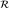
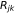
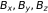
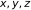
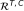
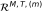
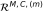
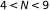
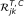

# Magnetic gradients and comparison diagnostics

| Summary | Details |
| --- | --- |
| Purpose | Estimate multipoint gradients and compare saved products. |
| Required inputs | Simulation-sampled observations and source simulation for gradient calculation; saved gradient HDF5 for postprocessing. |
| Entry points | `hsobs-analyze CONFIG`; `magnetic_gradient`, `magnetic_gradient_correlation`; installed plotters below. |
| Outputs | Gradient/correlation HDF5, diagnostic figures, comparison JSON/CSV. |
| Limitations | Finite-configuration affine approximation; offset access; model/reference mismatch; bootstrap unavailable. |


## `magnetic_gradient`

| Summary | Details |
| --- | --- |
| Purpose | Estimate the full multipoint gradient tensor. |
| Required inputs | Observation product and complete simulation reference; offsets when active. |
| Entry points | `analysis.method: magnetic_gradient`. |
| Outputs | Calculation-only HDF5; separate plotter. |
| Limitations | Finite-scale affine fit differs from point/coarse gradient truth. |

Computes full multi-spacecraft magnetic-field gradients from numerical-
simulation observations and writes a calculation-only HDF5 product. It uses
the general N-point least-squares method from Equation 2 of Broeren & Klein
(2024), summing each of the N(N-1)/2 independent spacecraft pairs once. The
same implementation handles four-spacecraft tetrahedra and all nine
spacecraft.

Gradient tensors use `gradient[field_component, spatial_derivative]`, so
`gradient[0, 1]` is dBx/dy. Positions are in km, magnetic fields and affine
residuals in nT, and gradients, curl, and divergence in nT/km. Geometry uses
the volumetric tensor R, sorted semiaxes `a >= b >= c`, `L = 2a`,
`E = 1 - b/a`, `P = 1 - c/b`, and `Q = chi = sqrt(E^2 + P^2)`.

The product distinguishes four quantities:

- `truth/coarse_*`: simulation-grid gradients averaged in a periodic sphere
  of diameter L around the true barycenter; this is the primary reference.
- `truth/point_*`: the simulation-grid gradient interpolated at the true
  barycenter.
- `true_estimate`: the least-squares result from nominal positions and true
  sampled magnetic fields.
- `measured`: realization-level results from stored observed fields, position
  offsets, and timing offsets after linear synchronization.

Coarse truth defaults to `truth.coarse_average_method: fft`. For each static
configuration size, this applies a periodic spherical top-hat convolution to
the simulation grid and trilinearly samples the convolved field along the
barycenter trajectory. It exactly matches direct grid-node averaging when the
barycenter lies on a grid node; off-grid centers interpolate between those
grid-centered averages. The original per-barycenter grid-node selection
remains available as `truth.coarse_average_method: direct`, including for
time-varying configuration sizes.

The primary solenoidal diagnostic is
`abs(divergence) / curl_magnitude`. A configuration-specific denominator
floor defaults to one percent of the median coarse-truth curl magnitude.
Samples below it retain raw curl/divergence, receive a NaN ratio, and have a
false ratio-validity mask.

Calculation reads the complete simulation definition from the generation
YAML embedded in the observation HDF5 file. `simulation_override` can update
relocated source paths without duplicating the layout and unit mapping.
Configuration selection defaults to the repository's established Q metric:
the smallest tetrahedron with `Q <= 0.6`, the best-shaped tetrahedron in
800--1200 km, the best-shaped tetrahedron at or above 1500 km, and all nine
spacecraft. See `configs/example_magnetic_gradient.yaml` for all controls.
An optional `best_multi` category selects the minimum-Q subset across every
five-, six-, seven-, and eight-spacecraft combination. It excludes all nine
because `all_nine` is stored as its own category. The legacy `large`
tetrahedron selector remains independently available.

```bash
hsobs-analyze configs/example_magnetic_gradient.yaml
hsobs-plot-magnetic-gradient outputs/magnetic_gradients.h5 \
  --output outputs/magnetic_gradients.png \
  --start-time 50 --stop-time 150
```

The plotting command opens only the saved gradient product; it never loads
the observation file or simulation and therefore cannot repeat the gradient
or coarse-volume calculations. By default its fourth row shows
`divergence`; the former `affine_rms_residual`, along with `condition_number`,
`chi`, and `d_ep`, remains selectable with `--row4` (`d_ep` is currently
recorded as unavailable/NaN). The fifth row shows the signed Cartesian
components of curl. Optional `--start-time` and `--stop-time` bounds select
an inclusive interval in analysis-time seconds; the plotted data and
automatic vertical limits both use only that interval.

An alternative compact figure isolates curl reconstruction errors:

```bash
hsobs-plot-magnetic-gradient outputs/magnetic_gradients.h5 \
  --output outputs/magnetic_gradient_error_decomposition.png \
  --layout error_decomposition \
  --start-time 150 --stop-time 200
```

Its first row shows coarse-truth, ideal, and measured median/IQR curl
magnitudes. Its second row retains the absolute curl-vector error against
coarse truth. The third row separates the normalized finite-scale error
`|C_T-C_C| / median_t|C_C|` from the measurement error
`median_MC|C_M-C_T| / median_t|C_C|`; the latter is evaluated separately for
each realization before taking the Monte Carlo median. Both time medians use
only the selected plotting interval. The decomposition requires products
written with `monte_carlo.store_all_realizations: true`.

### Curl-magnitude Wasserstein decomposition

Saved magnetic-gradient products can also be compared with the lightweight
`hsobs-plot-magnetic-gradient-wasserstein` postprocessor. For coarse truth
`C`, the error-free spacecraft estimate `T`, and measured MC member `M`, it
computes empirical one-dimensional distances over their common valid times:

- intrinsic method error: `W1(T, C)`;
- measurement error: `W1(M, T)`;
- total error: `W1(M, C)`.

Raw distances use nT/km. Dimensionless distances divide all three quantities
by the median positive coarse-truth curl magnitude for that configuration.
Each measured distance is calculated separately for every MC member and
reported as its median and interquartile range. A normalized pointwise median
absolute error between `M(t)` and `T(t)` complements the distributional
metric, which intentionally ignores temporal ordering.

The isolated terms obey the Wasserstein triangle inequality but are not an
additive error budget. Run the configured `2xx` comparison with:

```bash
scripts/plot_sim_prod_2xx_magnetic_gradient_wasserstein.sh
```

The YAML controls case labels and writes the figure plus JSON and CSV
diagnostics. Missing case products are warned about and skipped, allowing the
comparison to be rerun as long calculations finish.

### Combined six-panel curl figure

The combined plotter selects the four-spacecraft configuration with the
lowest median `Q` and arranges time-domain and distributional diagnostics in
a 2x3 figure:

- top: signed x component of curl, curl magnitude, and curl-vector error
  against coarse truth;
- bottom: empirical curl-magnitude CDF, normalized Wasserstein distances, and
  normalized pointwise measurement error.

The curl-x panel shows coarse truth, ideal estimate, and the measured Monte
Carlo median/IQR. The configured simulation comparison can be generated with:

```bash
scripts/plot_sim_prod_4xx_magnetic_gradient_combined.sh
```

The defaults in
`analysis/sim-prod-4xx_magnetic-gradient-combined.yaml` select 150--200 s for
the top row and the 5th--95th percentile interval for the bottom-row Monte
Carlo error bars. Command-line options can override the top-row interval,
output, configuration, and DPI.

## `magnetic_gradient_correlation`

| Summary | Details |
| --- | --- |
| Purpose | Compare signed component variation in saved gradients. |
| Required inputs | Standalone magnetic-gradient HDF5. |
| Entry points | `analysis.method: magnetic_gradient_correlation`; separate plotting CLI. |
| Outputs | Correlation HDF5 with validity/regression metrics and figures. |
| Limitations | Autocorrelation prevents ordinary independent-sample p-values; bootstrap unavailable. |

See the [example manifest](../examples/index.md) for prerequisites and verification status,
and [visualization guide](../user-guide/visualization.md) for inspection and plotting.

This post-processing analysis adapts the Pearson product-moment coefficient
from Equation 6 of Broeren & Klein (2024) to paired time samples of saved
magnetic-gradient components. It reads an existing `magnetic_gradient` HDF5
product and never recomputes gradients from spacecraft or simulation data.
Calculation and plotting are separate:

```bash
scripts/run_sim_prod_400_magnetic_gradient_correlation.sh
scripts/plot_sim_prod_400_magnetic_gradient_correlation.sh
```

The symbol  denotes the Pearson coefficient in figures and
documentation. It is distinct from the volumetric tensor  used by
the least-squares gradient estimator. Gradient indices remain
`gradient[field_component, derivative_direction]`; therefore matrix rows are
, columns are derivatives with respect to , and
`gradient[0, 1]` is .

For every tensor or signed-curl component, the product stores:

- ideal-versus-coarse correlation ;
- measured-versus-ideal correlation
  , evaluated independently for every MC realization;
- optionally measured-versus-coarse correlation
  ;
- common valid-sample count and fraction, input standard deviations, validity
  status and failure reason;
- normalized RMSE, plus the slope and intercept of
  `estimate = intercept + slope * reference`.

Measured percentiles are taken only after calculating realization-level
correlations. In particular, the code never correlates the measured median
time series with the ideal series. The default interval is the 5th--95th
percentile. Constant or nearly constant inputs and comparisons with fewer
than `minimum_valid_samples` common samples remain NaN rather than being
replaced by zero.

Pearson correlation measures similarity of temporal variation: positive
values indicate in-phase variation, negative values indicate anticorrelation,
and values near zero indicate little linear correspondence. It is insensitive
to constant offsets and multiplicative amplitude bias, which is why NRMSE and
linear-regression diagnostics are saved alongside it. These are descriptive
time-series metrics; ordinary independent-sample Pearson p-values are not
reported because adjacent samples are autocorrelated.

The correlation selector ranks the configurations already stored in the
source gradient product. It chooses the best and second-best N=4
configurations, the best configuration with , and all nine
spacecraft. Ties are broken by lower shape metric, then lower volumetric
tensor condition number, lower characteristic size, and finally
lexicographic spacecraft-index order. A warning is emitted when the two N=4
sizes differ by more than the configured factor, but the selection is not
changed.

The publication heat map is a common-scale 2x4 grid. Its top row shows
, and its bottom row shows
`median_m(R^{M,T,(m)}_{jk})`; all panels use the fixed range [-1, 1]. The
summary figure compares the median and minimum tensor-component correlation
and the median signed-curl-component correlation. Measured summary
percentiles are calculated from realization-level scalar summaries, not from
the median correlation matrix. The combined layout places that summary below
the heat maps. An additional measured-only figure shows the
measured-versus-ideal heat maps, annotates every valid cell to three decimal
places, and places an M,T-only scalar summary panel with a focused
`[0.7, 1.0]` correlation axis below them. A separate debug figure uses the
stored selected-component time series and regression diagnostics, so all
plotting reads only the standalone correlation product.

The example configuration is
`analysis/sim-prod-400_magnetic-gradient-correlation.yaml`. Moving-block
bootstrap uncertainty is reserved by the configuration schema but is
currently disabled and not implemented.


## Interpretation and evidence

See the [dated divergence audit](../research-notes/magnetic-gradient-divergence-audit.md)
for the pair-normalization derivation, independent checks and finite-scale
limitations. An exactly fitted tetrahedron has zero affine residual by
construction; this is not evidence of a spatially linear underlying field.
Measured gradient calculation uses stored coordinate offsets. Plotting a saved
product does not rerun simulation sampling.

The Pearson amplitude-bias wording above is retained pending review of sign
qualification; see the [scientific checklist](../developer/scientific-review.md).
