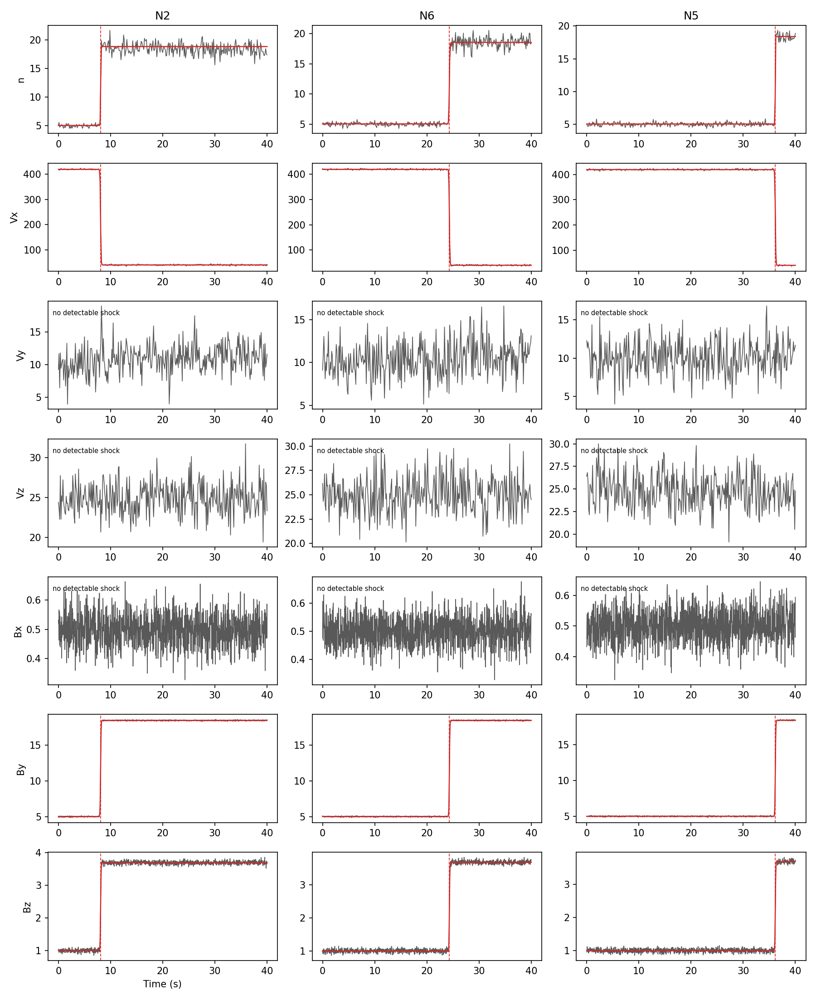
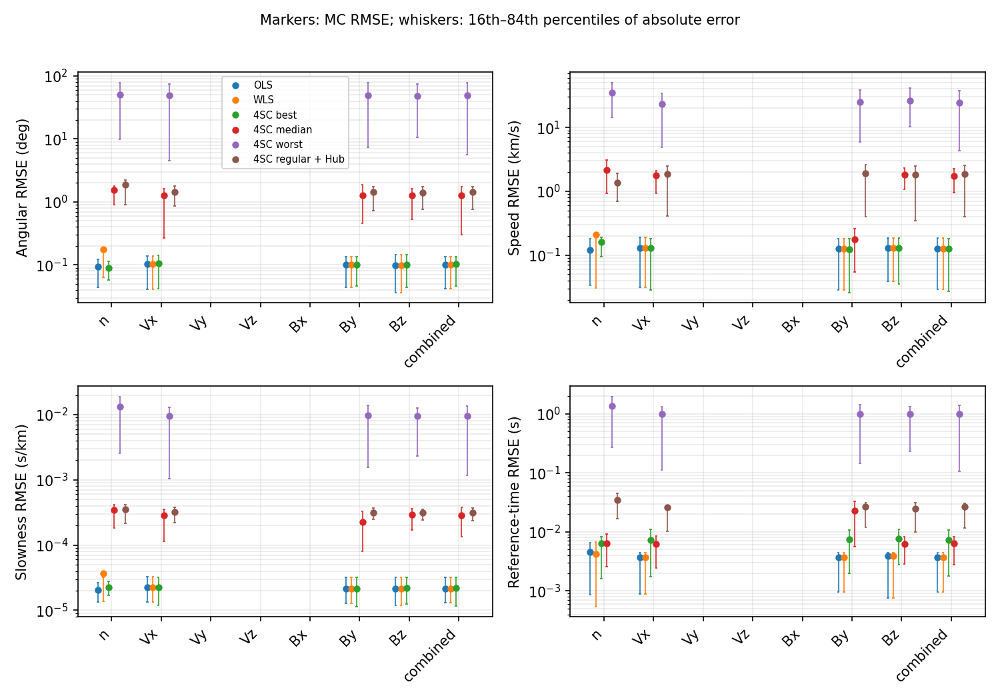
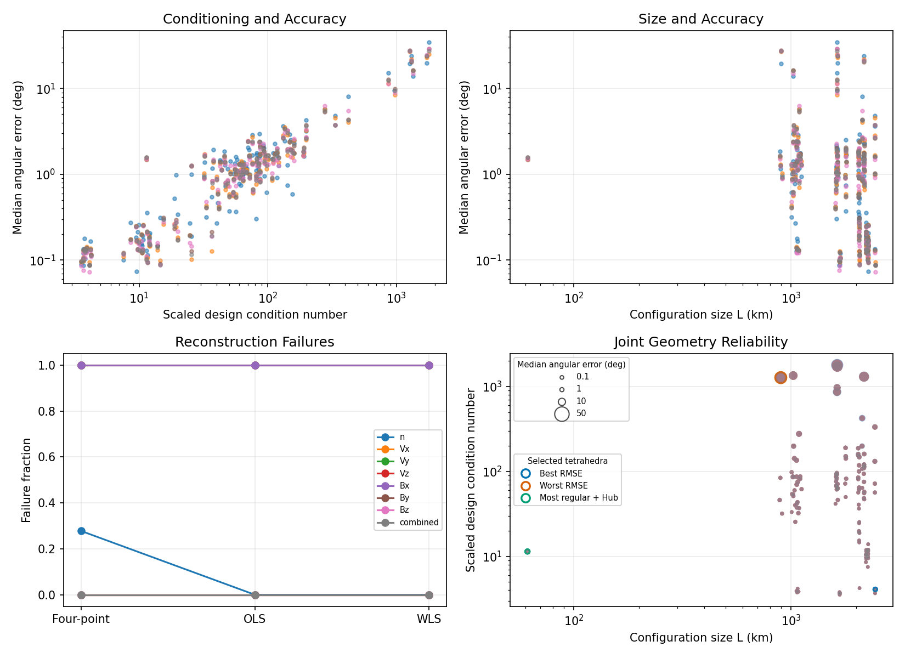

# Shock timing

| Summary | Details |
| --- | --- |
| Purpose | Recover a planar shock propagation normal, speed and crossing time. |
| Required inputs | Observed n/v/B and nominal trajectories; SciPy (`.[analysis]`); optional shock metadata for validation. |
| Entry points | `hsobs-analyze configs/example_analyze_shock_timing.yaml` after shock generation. |
| Outputs | Detection/inversion HDF5 and four PDF/PNG figure families. |

### Shock-timing analysis

`shock_timing` detects shock crossings independently in density, velocity
components, and magnetic-field components, or jointly fits accepted channels
at each spacecraft. It compares every conventional four-spacecraft timing
solution with global OLS and crossing-uncertainty-weighted WLS solutions:

```bash
hsobs-analyze configs/example_analyze_shock_timing.yaml
```

The model is `t_i = t_ref + q dot (r_i-r_ref)`, with slowness
`q = n_prop/V_sh`. Detection and inversion use observed values and nominal
positions only; injected errors and generated truth are never used in either.
When compatible shock metadata exist, a separate validation layer reports
actual normal, speed, slowness, reference-time, and arrival-time errors. The
generator normal points upstream-to-downstream, while `n_prop` points along
propagation and can therefore have the opposite sign.

The HDF5 result retains per-MC detections, contributors, all named tetrahedra,
OLS/WLS solutions, residuals, status codes, per-combination percentiles, paired
success counts, optional truth errors, and the identities of the empirical
best/worst tetrahedra. Detection, log-RMSE accuracy, geometry/reliability, and
mesocentric best/worst-tetrahedra figures are written as PDF and PNG. The last
figure combines 3-D formation projections and highlighted baselines with
`E`/`P` and `L` shape panels. The method assumes one planar constant-speed
transition; thresholds and fit-derived timing errors are diagnostic
approximations, and correlated four-point solutions are not independent
samples.

## Detection, products and validation

## Shock timing

The `shock_timing` method reconstructs a planar shock's propagation normal,
positive normal speed, slowness vector, and reference crossing time from every
observed Monte Carlo realization. It searches `n`, `Vx`, `Vy`, `Vz`, `Bx`,
`By`, and `Bz` without consulting truth, fits significant positive or negative
tanh profiles, and supports independent observable fits, a native-cadence
combined fit, or both.

For each fit it solves every available four-spacecraft combination plus global
OLS and inverse-crossing-time-variance WLS. Nominal positions are interpolated
at measured crossing times. Missing or ambiguous crossings, invalid weights,
insufficient spacecraft, rank deficiency, and poor geometry remain explicit
status codes. Nine valid spacecraft yield 126 separately summarized
tetrahedra.

```bash
hsobs-analyze configs/example_analyze_shock_timing.yaml
```








The HDF5 product contains detection diagnostics and channel masks,
reconstructed parameters and residuals, optional per-realization truth errors,
per-method and per-tetrahedron 16th/median/84th percentiles, paired-success
counts, and failure records. Four PDF/PNG products show profile fits,
reconstruction accuracy, geometry/reliability, and the best/worst tetrahedral
geometry. Accuracy panels report MC RMSE on logarithmic axes, with whiskers
showing the 16th–84th percentile range of absolute realization-level errors;
the four-spacecraft series include the best, median, worst, and minimum-`Q`
Hub-containing tetrahedra. The reliability panel uses a logarithmic axis for
median angular error and compares it separately with design condition number
and configuration size `L`. Its joint-geometry panel plots `L` against the
scaled design condition number with marker area encoding median angular error.
The
tetrahedral view uses the combined fit when available, highlights the
empirical best and worst angular-error-RMSE subsets plus the minimum-`Q`
tetrahedron containing the Hub in the established mesocentric 3-D
projections, and places their size/shape (`L`, `E`, and `P`) diagnostics
alongside it.

Synthetic validation uses the generator plane equation and moving nominal
trajectories. The propagation normal is `sign(n_hat dot V_S) n_hat`, distinct
from the upstream-to-downstream generator normal. Without shock metadata, core
reconstruction and residual diagnostics remain available and truth groups are
omitted. Limitations include the planar constant-speed approximation,
heuristic detection thresholds, approximate fit-derived timing uncertainties,
and no analytical covariance propagation. Correlated tetrahedra are never
pooled as independent Monte Carlo samples.


## Configuration and dependencies

The complete controls are in
[`configs/example_analyze_shock_timing.yaml`](https://github.com/kgklein/hs-observatory/blob/main/configs/example_analyze_shock_timing.yaml):
`modes`, `observables`, `truth_validation`, detection windows/significance,
fitting widths/coverage/residual limits, timing conditioning/uncertainty floors,
compression and four plot destinations. Read the [shock field definition](fields.md#propagating-planar-mhd-shocks)
first. Shock generation itself does not require the SciPy fitter.
