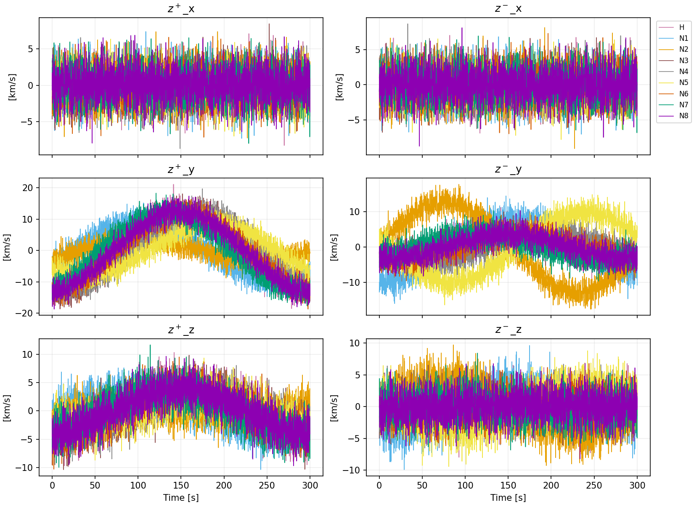
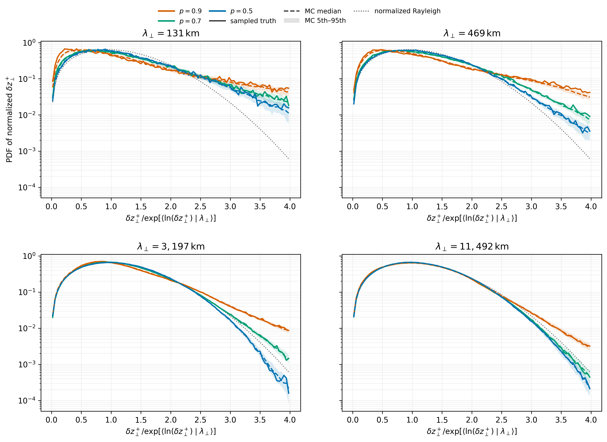
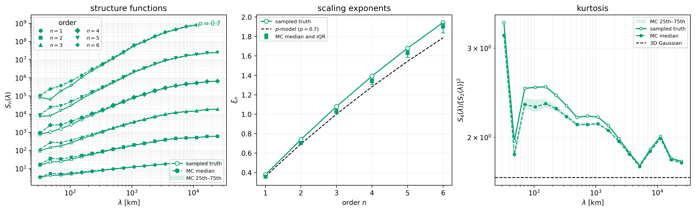

# Statistical analyses

| Summary | Details |
| --- | --- |
| Purpose | Compute derived fields, spatial statistics and single-spacecraft spectra. |
| Required inputs | Observation HDF5 with the variables, coordinates and metadata required below. |
| Entry points | `hsobs-analyze CONFIG`; selectors and configuration sections below. |
| Outputs | JSON or HDF5 plus optional diagnostic/publication figures. |
| Limitations | Native sampling, ensemble handling and frozen-field assumptions differ by method. |

## `diagnostics`

| Summary | Details |
| --- | --- |
| Purpose | Sanity-check generated data. |
| Required inputs | Generated observation HDF5 including truth. |
| Entry points | `analysis.method: diagnostics`. |
| Outputs | JSON statistics and separation summaries. |
| Limitations | Reader currently requires truth. |

Basic JSON sanity report for generated observations.

- Config section: none beyond `analysis.method`.
- Inputs: generated HDF5 observations.
- Output: JSON by default.
- Computes observed means/stds, residual means/stds against generated truth, and spacecraft-separation summaries for `n`, `v`, and `B`.

## Elsasser derived quantities

| Summary | Details |
| --- | --- |
| Purpose | Derive z-plus/z-minus and Alfvén velocity. |
| Required inputs | n, v, B, time/frame metadata; one observed member or truth. |
| Entry points | `analysis.method: elsasser`; section `elsasser`. |
| Outputs | HDF5 and optional six-panel PNG. |
| Limitations | Proton-only density; linear cadence alignment; no anti-alias filtering. |

The selectable `elsasser` analysis computes the convention

```text
z_plus  = delta_v + delta_b
z_minus = delta_v - delta_b
```

where `b = B / sqrt(mu0 n m_p)` is magnetic field in Alfvén-speed units and
`delta_v` and `delta_b` subtract a separate full-time mean for every
spacecraft. Inputs use the package conventions `n` in cm^-3, `B` in nT, and
`v` in km/s; `b` and both Elsasser fields are written in km/s. This first
implementation assumes proton mass density only. Both density normalization
and mean subtraction default to `global_per_spacecraft`; density normalization
may instead be `instantaneous`.

Run the observed-data example with:

```bash
hsobs-analyze configs/example_elsasser.yaml
```



*Elsasser Fields constructed from HS measurement of a sinewave.*


Set `elsasser.data_group: truth` to use plasma-frame `/truth/v`, `/truth/n`,
and `/truth/B`. Observed analysis selects one `mc_index`. Its velocity frame
can be explicit or inferred from generated-file metadata; spacecraft-frame
velocity is restored to the plasma frame using stored trajectory information.
The method chooses the slower native `n`/`v` grid and linearly interpolates
the other variables, including higher-cadence `B`, onto it. Anti-alias
filtering for large cadence ratios is a future extension.

The output layout is:

```text
/metadata                         convention, selection, units, and methods
/time                             (n_time_out,)
/spacecraft/id                    (n_spacecraft,)
/elsasser/z_plus                  (n_time_out, n_spacecraft, 3)
/elsasser/z_minus                 (n_time_out, n_spacecraft, 3)
/alfven/b                         (n_time_out, n_spacecraft, 3)
/alfven/delta_b                   (n_time_out, n_spacecraft, 3)
/velocity/v_plasma                (n_time_out, n_spacecraft, 3)
/velocity/delta_v                 (n_time_out, n_spacecraft, 3)
/density/n                        (n_time_out, n_spacecraft)
/density/n_normalization          (n_spacecraft,) for the default method,
                                   otherwise (n_time_out, n_spacecraft)
```

When plotting is enabled, the diagnostic is a three-row by two-column grid:
x/y/z components by `z_plus`/`z_minus`, with all spacecraft overlaid.

The physical calculation lives in
`hs_observatory.analysis.derived.elsasser`, independently of the HDF5 wrapper.
Future analyses should import that common utility rather than implementing a
second Elsasser convention.

## Static Elsasser-increment PDFs

| Summary | Details |
| --- | --- |
| Purpose | Estimate scale-conditioned increment PDFs. |
| Required inputs | Frozen-field n/v/B samples and coordinates. |
| Entry points | `analysis.method: elsasser_increment_pdf_static`. |
| Outputs | HDF5 moments, histograms, optional samples and plots. |
| Limitations | Frozen-field assumption; no dynamical interpretation; missing higher diagnostics below. |

`elsasser_increment_pdf_static` creates scale-conditioned PDFs inspired by
Mallet et al. (2015), Fig. 1:

```bash
hsobs-analyze configs/example_elsasser_increment_pdf_static.yaml
```



*Elsasser Field increments constructed from HS measurement of a p-model turbulence.*

The method reads an ordinary synthetic-observation file and calls the common
Elsasser implementation internally for both truth and one configured observed
MC member. It treats every `(time, spacecraft)` sample as a point in one frozen
spatial field. All unique unordered pairs are included: simultaneous
inter-spacecraft baselines, different-time cross-spacecraft baselines, and
same-spacecraft track baselines. Time differences have no dynamical meaning;
the method uses neither temporal lags nor Taylor's hypothesis.

By default, the pair scale and Elsasser increments are projected perpendicular
to the local pairwise mean field `0.5 * (B_A + B_B)`. A global mean-field
direction is used when that local field is too small. Each positive increment
is normalized within its scale bin by
`exp(mean(log(increment)))`. The pair upper triangle is streamed repeatedly in
bounded chunks: one pass finds scale limits, one accumulates moments and
geometric means, a bounded priority sample estimates the normalized-increment
percentile, and a final pass builds PDF histograms. `pair_sampling.mode:
random` is also available and samples unique pairs reproducibly without
replacement; `max_pairs` bounds either mode for debugging.

The HDF5 product contains one subtree per configured dataset:

```text
/results/<dataset>/lambda/bin_edges
/results/<dataset>/lambda/bin_centers
/results/<dataset>/lambda/counts
/results/<dataset>/lambda/valid_bin
/results/<dataset>/pdf/z_plus/{bin_edges,bin_centers,density,counts}
/results/<dataset>/pdf/z_plus/{typical_increment,rms_increment,fourth_root_increment}
/results/<dataset>/pdf/z_minus/...       same products
/results/<dataset>/alignment/{mean_sin_theta,counts}
/results/<dataset>/samples/...           only when explicitly enabled
```

Plotting writes one normalized `z_plus` PDF figure for each dataset, with one
curve per sufficiently populated perpendicular-scale bin. The method does not
yet implement the Fig. 1 inset, parallel coherence length, nonlinear or
Alfvén times, refined-critical-balance `chi`, or the Fig. 4 conditional
alignment diagnostic.

## Static PDF configuration


Builds scale-conditioned PDFs of Elsasser increments between `(time, spacecraft)`
samples interpreted as points in a frozen spatial field, including simultaneous
and different-time pairs.

- Config section: `elsasser_increment_pdf_static`.
- Output: HDF5 plus optional PDF diagnostic plots.
- Controllable parameters:
  - `datasets`: list of named datasets with `data_group` and optional `mc_index`.
  - `elsasser`: nested settings passed to the `elsasser` calculation.
  - `increments.plotted_field`: `z_plus` or `z_minus`.
  - `increments.component`: `perpendicular` or `full_vector`.
  - `mean_field.method`: currently `local_pairwise` only.
  - `mean_field.fallback`: currently `global_mean_B` only.
  - `mean_field.min_norm`.
  - `scale_bins.separation`: `perpendicular` or `full`.
  - `scale_bins.binning`: `log` or `linear`.
  - `scale_bins.n_bins`, `lambda_min`, `lambda_max`, `min_samples_per_bin`.
  - `pdf_bins.n_bins`, `x_min`, `x_max`, `x_max_percentile`.
  - `pair_sampling.mode`: `all` or `random`.
  - `pair_sampling.n_pairs`, `max_pairs`, `chunk_size`, `random_seed`.
  - `alignment.compute`.
  - `output_samples.save`, `output_samples.max_samples`.
  - `plot.enabled`, `plot.directory`, `plot.yscale`, `plot.xscale`, `plot.dpi`.

Examples: `configs/example_elsasser_increment_pdf_static.yaml`,
`configs/malara_elsasser_increment_pdf_static.yaml`.

## Static spatial decorrelation analysis

| Summary | Details |
| --- | --- |
| Purpose | Measure simultaneous spatial correlations and second-order differences. |
| Required inputs | Native-cadence values/positions; truth or one MC member. |
| Entry points | `analysis.method: static_decorrelation`; section `decorrelation`. |
| Outputs | Binned HDF5 statistics and diagnostic PNG. |
| Limitations | No temporal lags or Taylor hypothesis; only order 2 here. |


`static_decorrelation` estimates simultaneous pairwise correlation as a function of spacecraft separation and computes the matching second-order pair-difference structure function. It treats every time index as an independent spatial snapshot. This first method intentionally includes no time lags, temporal evolution, Taylor hypothesis, flow advection, or wave propagation.

Run it after generating observations:

```bash
hsobs-generate configs/example_generate.yaml
hsobs-analyze configs/example_static_decorrelation.yaml
```

The analysis supports scalar density correlation, vector dot-product correlation, optional vector-component correlations, normalized or raw products, and linear or logarithmic separation bins. `data_group: observed` selects one `mc_index`; `data_group: truth` ignores it. `mc_index: all` is reserved for future ensemble statistics and currently raises `NotImplementedError`.

The default `per_time` mean subtracts the constellation mean independently at each snapshot. `global` subtracts one scalar or vector mean over all selected times and spacecraft. With the current native-cadence HDF5 schema, each variable uses its matching `/spacecraft/r/{variable}` positions. All selected variables share common bin edges, while `/counts/{variable}` records cadence-dependent sample counts.

The HDF5 output contains bin edges, lower and upper edges, centers, per-variable counts, correlation means/standard deviations/standard errors, and corresponding second-order structure-function statistics. Empty bins have count zero and NaN statistics. A default diagnostic PNG is written beside the HDF5 file as `<output_stem>_diagnostic.png`; it shows correlation and standard-error bands in the left column and second-order structure functions in the right column.

```yaml
analysis:
  method: static_decorrelation

decorrelation:
  variables: [n, v, B]
  data_group: observed
  mc_index: 0
  mean: {method: per_time}
  separation:
    units: km
    binning: log
    n_bins: 30
    r_min: null
    r_max: null
  correlation:
    vector_mode: dot
    component_correlations: true
    normalize: true
  structure_function: {compute: true, order: 2}
  visualization:
    enabled: true
    path: outputs/static_decorrelation_diagnostic.png
    dpi: 150
```

## Decorrelation configuration


Computes simultaneous pairwise correlations and second-order pair-difference
structure functions versus spacecraft separation.

- Config section: `decorrelation`.
- Output: HDF5 plus optional diagnostic PNG.
- Controllable parameters:
  - `variables`: any nonempty subset of `n`, `v`, `B`.
  - `data_group`: `truth` or `observed`; default `observed`.
  - `mc_index`: observed Monte Carlo member; default `0`; `all` is not implemented.
  - `mean.method`: `per_time` or `global`.
  - `separation.units`: currently `km` only.
  - `separation.binning`: `log` or `linear`.
  - `separation.n_bins`, `r_min`, `r_max`.
  - `correlation.normalize`.
  - `correlation.component_correlations`.
  - `structure_function.compute`; `structure_function.order` is currently `2`.
  - `visualization.enabled`, `visualization.path`, `visualization.dpi`.

Example: `configs/example_static_decorrelation.yaml`.

## Single-spacecraft FFT analysis

| Summary | Details |
| --- | --- |
| Purpose | Measure each spacecraft frequency spectrum. |
| Required inputs | Uniformly sampled native time series. |
| Entry points | `analysis.method: timeseries_fft`; section `fft`. |
| Outputs | PSD HDF5 and observed/truth figures. |
| Limitations | No frequency-to-wavenumber conversion; no irregular-grid estimator. |


`timeseries_fft` computes one-sided real-FFT power spectral densities independently for every spacecraft time series. It uses no multi-spacecraft separation or spatial information and performs no Taylor-hypothesis conversion from frequency to wavenumber. Input time axes must be uniformly sampled; nonuniform data currently raise an error rather than being interpolated or passed to Lomb–Scargle analysis.

Run the example after generating observations:

```bash
hsobs-generate configs/example_generate.yaml
hsobs-analyze configs/example_timeseries_fft.yaml
```

Density is stored as `/psd/n`. Velocity and magnetic spectra are stored both by component as `/psd/v_components` and `/psd/B_components`, with shape `(spacecraft, frequency, 3)`, and as trace sums `/psd/v_trace` and `/psd/B_trace`. For shared-cadence input, `/frequency` is one dataset. Native-cadence files use `/frequency/{variable}` so density, velocity, and magnetic spectra retain their distinct instrument frequency grids.

With time step `dt` and window `w`, the normalization is

```text
PSD(f) = dt / sum(w^2) * |rFFT(w x)|^2
```

Strictly positive non-Nyquist bins are doubled, yielding units of quantity²/Hz.
Mean detrending and a Hann window are enabled by default.
The DC bin is saved but omitted from the default log-log diagnostic plot, which overlays all spacecraft in panels for density, velocity trace, and magnetic trace.
All panels use the same frequency-axis limits; native lower-cadence products therefore retain blank space above their Nyquist frequencies.

When analyzing `data_group: observed`, plotting also computes the corresponding truth spectra and writes them under `/truth_psd` in the analysis HDF5 file. The selected Monte Carlo realization and truth are rendered as separate figures by default, using identical axes and styling. For each parameter with positive truth spectral power, both figures use a common y-axis range spanning the observed and truth spectra. Parameters with zero truth power retain an independently autoscaled observed panel and an annotated zero-power truth panel. Set `plot.truth_enabled: false` to suppress the truth product.

```yaml
analysis:
  method: timeseries_fft

fft:
  data_group: observed
  mc_index: 0
  variables: [n, v, B]
  detrend: mean
  window: hann
  normalization: psd
  plot:
    enabled: true
    path: outputs/timeseries_fft.png
    truth_enabled: true
    truth_path: outputs/timeseries_fft_truth.png
    loglog: true
    overlay_spacecraft: true
    show_components: false
```

## FFT configuration


Computes one-sided real-FFT power spectral densities independently for each
spacecraft time series.

- Config section: `fft`.
- Output: HDF5 plus optional diagnostic PNGs.
- Controllable parameters:
  - `variables`: any nonempty subset of `n`, `v`, `B`.
  - `data_group`: `truth` or `observed`; default `observed`.
  - `mc_index`: observed Monte Carlo member; default `0`; `all` is not implemented.
  - `detrend`: `mean` or `none`.
  - `window`: `hann` or `none`.
  - `normalization`: currently `psd` only.
  - `plot.enabled`, `plot.path`, `plot.truth_enabled`, `plot.truth_path`.
  - `plot.loglog`, `plot.overlay_spacecraft`, `plot.show_components`, `plot.dpi`.

Examples: `configs/example_timeseries_fft.yaml`,
`configs/malara_timeseries_fft.yaml`.

## `structure_function`

| Summary | Details |
| --- | --- |
| Purpose | Measure Elsasser increment moments and scale exponents. |
| Required inputs | Observation n/v/B and positions; independent MC members. |
| Entry points | `analysis.method: structure_function`. |
| Outputs | JSON moments/counts/flatness/fits and optional figures. |
| Limitations | Pair counts and selected spatial/fit assumptions limit inference. |

See the [visualization guide](../user-guide/visualization.md) for inspection and plotting.

Binned Elsasser vector-increment structure functions. The default uses same-time spacecraft pairs; `increment_mode: all_spacetime_pairs` also treats samples as points of a frozen field.

- Config section: `structure_function`.
- Output: JSON by default, plus optional diagnostic PNG.
- Computes `z_plus` and `z_minus` through the shared Elsasser helper, then bins
  vector increment magnitudes by spacecraft-pair separation in the repository's
  native km coordinate units.
- Observed Monte Carlo members are processed independently; no ensemble average
  is performed. Truth is computed separately when present.
- Current controls:
  - `min_order`, `max_order`: integer order range; defaults `1` through `6`.
  - `n_lambda_bins`: number of data-driven logarithmic separation bins.
  - `lambda_bins_km`: optional explicit separation bin edges in km.
  - `scale_ranges_km`: optional named fit ranges, for example `total: [10, 10000]`.
  - `min_fit_bins`: minimum populated bins for log-log exponent fits; default `3`.
  - `elsasser`: nested settings passed to the `elsasser` calculation.
  - `plot.enabled`, `plot.path`, `plot.field`, `plot.member`,
    `plot.data_group`, `plot.normalized_exponents`, `plot.dpi`.
  - `plot.p_value`: optional p-model reference in the diagnostic exponent panel,
    for example `0.9`; omitted by default. With normalized exponents the reference
    is also divided by its order-2 exponent.
- Returned products include `S_n[member, order, bin]`, `counts[member, bin]`,
  `flatness = S4 / S2^2` when orders 2 and 4 are available, and raw plus
  order-2-normalized scaling exponents for each named scale range.

Dataset and realization selection is optional. With no selection controls, the
runner processes every observed realization and also truth when present, as before.
Explicit `data_groups` must be a nonempty list containing `truth`, `observed`, or
both; explicitly requested groups must exist in the input. `mc_indices` defaults
to `all`, or accepts a nonempty list of distinct zero-based nonnegative integers.
Indices must be in range when `observed` is selected. Duplicate groups and indices
are errors. MC selection applies only to `observed`.

For example, establish scale coverage and convergence from the sampled truth
without reading or computing the observed ensemble:

```yaml
structure_function:
  data_groups: [truth]
  plot:
    enabled: false
    publication:
      enabled: false
```

To compare truth with three observed realizations:

```yaml
structure_function:
  data_groups: [truth, observed]
  mc_indices: [0, 1, 2]
```

For observed-only analysis, use `data_groups: [observed]` with either
`mc_indices: all` or an explicit list. The member axis follows the list's order.
For an explicit MC list, `products.observed.mc_indices` records the original
indices corresponding to that axis; existing product arrays keep their format.
Diagnostic `plot.member` selects a position on this output member axis.

Publication plotting requires both truth and at least one observed realization;
`plot.publication.enabled: true` with a single selected group raises a
configuration error before computation. With a subset, the publication plot
computes its usual ensemble intervals from the selected members only.
Normalization, SF definitions, pair sampling, seeds, and fitting procedures are
unchanged. Automatic separation bins use the selected datasets' geometry; supply
identical explicit `lambda_bins_km` when comparing subset and full-run values.

### Member processes

`hsobs-analyze` accepts a positive integer `--workers N` for `structure_function`.
The default, `--workers 1`, uses the existing serial execution path. Larger values
use spawned processes across selected truth/MC members, with at most `N` active
workers (and never more workers than members). No YAML worker option is needed.

```bash
# Existing serial path
.venv/bin/hsobs-analyze analysis/malara-prod-600_sf-short-v00.yaml --workers 1

# One workstation analysis with four member processes
OMP_NUM_THREADS=1 OPENBLAS_NUM_THREADS=1 MKL_NUM_THREADS=1 \
  .venv/bin/hsobs-analyze analysis/malara-prod-600_sf-short-v00.yaml --workers 4
```

Select both truth and observed members to benefit from member parallelism;
a truth-only selection has just one member. Workers open the input HDF5 file
independently and read only their member. Input files must remain unchanged during
the run. Pair samplers, seeds, chunk sizes, moment accumulation, and estimators
are unchanged. Results retain selection order and are fitted after assembly
using each group's common fit ranges. Geometry `plan_reused` diagnostics describe
the logical serial two-entry cache, not physical reuse between processes.
Worker count is not added to the output schema or scientific configuration.

For a single-node Puma allocation, adapt the following batch-script fragment to
the partition and memory allocation appropriate for the input:

```bash
#SBATCH --nodes=1
#SBATCH --ntasks=1
#SBATCH --cpus-per-task=4

export OMP_NUM_THREADS=1 OPENBLAS_NUM_THREADS=1 MKL_NUM_THREADS=1
srun .venv/bin/hsobs-analyze analysis/malara-prod-600_sf-short-v00.yaml \
  --workers "$SLURM_CPUS_PER_TASK"
```

Set numerical-library thread limits before starting Python, and choose a worker
count within the allocated CPU and memory budget. This pool uses one node;
it does not distribute work across nodes. Python callers can use
`analyze_from_config(path, workers=4)` or
`StructureFunctionAnalysis(options).run(input_path, workers=4)` from an importable
script protected by `if __name__ == "__main__":` for spawn safety. Other analysis
methods reject worker counts greater than one.

Stage 1 retains a serial common-bin preparation pass, discards each prepared
member's large field arrays, then rereads/recomputes preprocessing in workers.
This trades repeated I/O for bounded preparation memory. Peak memory grows with
active workers and each sampler's workspace; compressed HDF5 reads can contend
for I/O. Each selected member keeps its existing seed, including shared pair
identities where the serial sampler shares them. Exact equality is validated
within the same numerical environment, not guaranteed across library versions
or CPU architectures.

`scripts/run-structure-functions.sh` already starts three configurations with
`xargs -P3`. Giving each configuration `N` workers would create up to `3N` compute
processes plus parents. Prefer one configuration per allocation when using all
its CPUs, or divide CPUs and memory explicitly between configurations.

A worker failure aborts the entire calculation with dataset/member context.
No JSON or plots are written until all members have completed and passed result
validation, so previous outputs survive a calculation failure. Pending work is
cancelled; running workers may finish during shutdown. There is no checkpointing
or resume, and the existing post-calculation writer is not a multi-file
transaction.

The publication summary plot reads this JSON result directly and keeps sampled
truth separate from the observed Monte Carlo ensemble:

```bash
hsobs-plot-structure-function structure_function.json \
  --p-value 0.9 --quantity z_plus --output sf_summary_p09.png
```



*Structure Function Analysis from p-model observations.*

Python callers can use `plot_structure_function_summary_row(...)` with a
supplied row of three axes when assembling multiple p-model rows, or
`plot_structure_function_summary(...)` to save a standalone 1x3 figure. The
default row colors are distinct for `p=0.5`, `0.7`, and `0.9`; `run_color` can
override them.

It can also be produced during analysis by adding a publication subsection:

```yaml
structure_function:
  plot:
    publication:
      enabled: true
      path: outputs/sf_summary_p09.png
      p_value: 0.9
      quantity: z_plus
      max_order: 6
      fit_range: total
      dpi: 300
```


### Additional implemented structure-function controls

`structure_function._settings` also accepts `min_pair_lambda_km`,
`max_pair_lambda_km` (alias `max_lambda_km`), `increment_mode`, and `pair_sampling`.
Modes are `all`, `random`, and `adaptive_stratified`. Random sampling requires
`n_pairs` and a seed. Adaptive stratification requires `all_spacetime_pairs`,
`target_pairs_per_bin`, `max_candidates`, and a seed; `binning_n_pairs` controls
the binning sample. `chunk_size` defaults to 1,000,000 and `binning_n_pairs` to
5,000,000. Bounds, sample counts and reported shortfalls affect interpretation.
These implemented controls supersede the old README's scaffold/TODO description;
they do not establish scientific suitability for every field.

Observed pair positions may incorporate `/errors/position_offset`; see
[data conventions](data-products.md#coordinate-use-by-analysis). Higher-order
moments and fitted exponents require adequate pair counts and an appropriate
fit range; no ensemble averaging is performed inside each member's statistic.

### Local logarithmic scaling diagnostic

The overlay command can post-process saved structure-function JSONs to calculate
`xi_local = d ln(S_n) / d ln(lambda)`. This exposes scale dependence that a
single global power-law fit can obscure. It does not change the saved global
fit range or recompute fields, observations, increments, or structure functions.
See the [visualization guide](../user-guide/visualization.md#local-structure-function-slopes)
for the production command and output locations.

#### Estimators and validity

- **Three-point regression (default):** regress `ln(S_n)` against `ln(lambda)`
  over consecutive bins `k-1, k, k+1`, using the actual bin centers, and assign
  the slope to `lambda_k`. The first and last slopes are `NaN`.
- **Adjacent bins:** divide the difference in `ln(S_n)` by the difference in
  `ln(lambda)` for consecutive bins and assign the slope to
  `sqrt(lambda_k * lambda_(k+1))`. Select with
  `--local-slope-method adjacent`.

Both estimators use natural logarithms. Nonfinite/nonpositive structure-function
values or separations and nonfinite/nonpositive pair counts invalidate the
corresponding samples. A neighborhood containing invalid samples or
non-increasing separations yields `NaN`; bins are never reordered and gaps are
never bridged. There are no asymmetric edge fits or extrapolated slopes.

Sampled-truth curves are processed separately. When individual MC curves are
stored, slopes are computed independently for every realization, then the
existing finite-member 5th, 50th and 95th percentiles are taken at each order
and separation. This differs from differentiating the median structure-function
curve. When individual MC curves are unavailable, MC slopes and bands are
omitted with a warning; uncertainty is not inferred from percentile curves.

The analytic reference is `zeta_n(p) = 1 - log2(p^(n/3) + (1-p)^(n/3))`.
It gives `zeta_3 = 1` for every p and `zeta_n(0.5) = n/3`. Reference values are
not imposed on the calculated slopes.

#### Plotting configuration and cascade context

The local mode reuses the overlay YAML's `cases`, `quantity`, `max_order`,
`dpi`, `show_p_model`, and `output.figure`. Case inputs may have different
separation grids. Relative paths resolve from the current working directory,
as in the existing overlay workflow. The default output prefix is the configured
figure stem plus `_local_slopes`; `--output-prefix` overrides it. The command
writes primary and focused PNG/PDF figures plus HDF5, and rejects `--output`,
`--fit-range`, `--fit-lambda-range`, and `--min-fit-bins` in local mode.

To enable contextual scale marks, supply a matching generation configuration
for each case and pass `--show-cascade-scales`:

```yaml
cases:
  "400":
    path: outputs/malara-prod-400_sf_publication.json
    p_value: 0.9
    generation_config: generation/malara-prod-400.yaml
```

Generation configurations are read only when marks are requested. The reader
requires explicit isotropic Malara domain lengths in km, injection/max scale
indices, and spectral exponent; it does not instantiate a field evaluator.
No production cascade parameters are assumed for arbitrary datasets.

Marks show nominal cell sizes `ell_m = L0 / 2^m`, selecting every third index
from injection plus the maximum index and retaining only sizes in the plotted
range. Eddies have compact support widths `2 * ell_m` along each coordinate.
These marks are context, not asserted inertial-range boundaries. The primary
figure shows each case's marks; the focused figure shows shared marks only when
the supplied domain lengths and selected indices agree across cases.

#### Derived HDF5 product

`<prefix>.h5` stores root attributes `schema_version`, `estimator`, `quantity`,
and `metadata_json`, including the plotting configuration path, creation time,
ensemble policy, and edge policy. Numbered groups `cases/0`, `cases/1`, … are
ordered by decreasing p and contain:

- Attributes `name`, `p_value`, `source_path`, optional `mc_limitation`, and
  optional `cascade_json` with generation provenance and scale parameters.
- Datasets `orders` and `theory`.
- A `truth` group and, when individual curves exist, an `mc` group with
  `source_centers_km`, `source_edges_km`, `coordinates_km`, `source_valid`,
  `slopes`, and `slope_valid`. Slopes and masks preserve `(member, order, bin)`
  axes; adjacent slopes have one fewer bin than the source arrays.
- Additional MC datasets `p05`, `median`, `p95`, and `finite_members`, shaped
  `(order, slope_bin)`. Missing slopes remain `NaN`; a count of zero means no
  finite MC slopes contribute at that location.

The input JSONs and original publication figure are preserved.
Python entry points live in `analysis.structure_function_local`, notably
`local_log_slopes`, `p_model_exponents`, and `local_slopes_from_config`.

#### Interpretation of the current production results

Current numerical findings, figures and open questions are maintained in
[Research Notes: Intermittency recovery](../research-notes/intermittency-recovery.md#local-slope-findings).
The nine-bin production results provide seven overlapping three-point estimates;
this limits the evidence for an extended plateau.

### Direct 3D spatial structure functions

The [ongoing intermittency investigation](../research-notes/intermittency-recovery.md#direct-3d-validation)
records the smoke-test status and the next pilot/convergence steps. This section
documents the implemented calculation and interfaces.

`spatial_structure_function` samples the raw three-component Malara fluctuation
field directly, bypassing trajectories, time series, instrument errors and
observation MC models. Its vector-magnitude moments use the same shared moment
helpers as the virtual-HS analysis. Global fits, local derivatives and p-model
predictions reuse the existing routines.

From the repository root, explicitly launch the pilot:

```bash
hsobs-analyze-spatial-structure-function \
  configs/example_spatial_structure_function.yaml
```

The example references `generation/malara-prod-401.yaml` and overrides only p
to evaluate 0.5, 0.7 and 0.9. It defaults to 2,000 pairs at each of 25 logarithmic
separations from 50 to 20,000 km. This is 100,000 point evaluations per case and
can be expensive. Increase `--n-pairs` to 5,000 or 50,000 explicitly; no production
calculation runs as part of tests. The standard dispatcher also accepts this
configuration through `hsobs-analyze CONFIG`; for this method, `input.path`
names the generation YAML rather than an observation HDF5 file.

The inexpensive production-field smoke command is:

```bash
hsobs-analyze-spatial-structure-function \
  configs/example_spatial_structure_function.yaml \
  --n-pairs 16 --lambda-centers-km 50 200 500 1000 20000 \
  --backend cached --smoke --output-prefix outputs/direct-spatial-sf-smoke
```

Smoke products test functionality only. Sixteen pairs split into eight batches
cannot establish high-order convergence or a scientific scaling plateau.

#### Spatial samples and reproducibility

Positions are uniform in the domain relative to the field origin, and directions
are isotropic. The second coordinate is the **unwrapped** position plus the
requested separation times the direction; the evaluator wraps both points into
the periodic domain. Raw evaluator normalization, field seed and realization
are preserved from the production adapter's base configuration. Backgrounds,
output-field amplitudes and Elsasser transformations are not applied.

The separation centers are exact evaluation magnitudes, not finite-width bins.
Configure `lambda_centers_km`, or `centers_from_hs: PATH_TO_SF_JSON` to sample
the existing HS truth centers without interpolation. CLI equivalents are
`--lambda-centers-km ...` and `--centers-from-hs PATH`. Logarithmic grids support
`--n-separations`, `--lambda-min-km` and `--lambda-max-km`. Their upper limit must
remain below half the smallest domain dimension; larger explicit centers are
allowed with a periodic-image warning.

The sampling seed is separate from the field's `base_seed`. Each exact separation
has its own deterministic stream, shared across p-values. With the seed and
domain unchanged, the first 2,000 coordinates of a 5,000-pair run match the
2,000-pair run, independently of processing chunk size. Extending a sample count
replays this prefix; resuming field evaluation from a previous product is not
implemented. Processing defaults to 128 pairs per task, bounded queues, and
task-local caches. The parallel path reuses the existing process-safe Malara
chunk evaluator inside a persistent pool, avoiding the existing high-level
parallel API's materialization of an entire evaluation result.

#### Fits, local slopes and sampling variability

The candidate window is 200–1,000 km. An additional comparison window of
100–1,300 km contains four of the saved HS centers, while the candidate window
contains only two. The default minimum of three points is retained; unavailable
HS fits are marked explicitly. These are diagnostic windows, not asserted
inertial-range boundaries, and are never selected automatically to match theory.

Eight disjoint contiguous sample batches supply moment standard deviations and
coefficients of variation. Local slopes are calculated separately for the full
sample and each batch; ±1 batch-SD bands are displayed only where at least three
batch slopes are finite. These bands describe **spatial sampling variability**,
not observation MC uncertainty or variability across independent turbulence
realizations. Batches share the same deterministic field and may sample
overlapping eddy supports. Cumulative 25/50/75/100% checkpoints use the same
evaluations and are saved for convergence inspection.

#### Saved products and cached plotting

The pilot writes `outputs/direct-spatial-sf.h5` and PNG/PDF pairs with suffixes
`_structure_functions`, `_local_slopes`, and, when HS inputs are available,
`_comparison`. The HDF5 retains effective field configurations, source YAML,
seeds, realization, exact centers, full/batch/checkpoint moments and counts,
batch variability, global slopes and residual diagnostics, local slopes and
validity masks, theory and HS comparison provenance. Each numbered `cases`
group represents one p-value; `q/S_n` uses `(member=1, order, separation)` axes.
Batch arrays use `(batch, order, separation)` axes. No artificial bin edges,
Elsasser aliases or observation-MC arrays are introduced.

Refit or regenerate figures from that product without evaluating the field:

```bash
hsobs-plot-spatial-structure-function outputs/direct-spatial-sf.h5 \
  --fit-lambda-range 200 1000 --fit-window comparison 100 1300 \
  --show-cascade-scales --output-prefix outputs/direct-spatial-sf-refit
```

The command writes a separate HDF5 product and records the source product path.
Additional windows use repeatable `--fit-window NAME MIN_KM MAX_KM`. Select
`--local-slope-method adjacent` for the existing adjacent-bin derivative.
`--comparison-config` accepts an existing HS overlay YAML; missing files omit
comparison cases with a warning, while malformed supplied products are errors.
Comparisons refit ideal HS curves on their own actual centers, without
interpolation or upstream recomputation. Raw q and processed HS Elsasser fields
differ in preprocessing, so this comparison alone does not identify spacecraft
sampling as the sole cause of a difference.

Python interfaces are in `analysis.spatial_structure_function`, including
`sample_spatial_pairs`, `SpatialStructureFunctionAnalysis`, `read_spatial_result`,
`spatial_plot_product`, and `postprocess_spatial_result`. Before reinstalling
console entry points, module fallbacks are available:

```bash
PYTHONPATH=src .venv/bin/python -m hs_observatory.cli_spatial_structure_function \
  sample configs/example_spatial_structure_function.yaml
PYTHONPATH=src .venv/bin/python -m hs_observatory.cli_spatial_structure_function \
  plot outputs/direct-spatial-sf.h5
```

### Diagnostics input requirement

The shared `read_observations` reader currently requires truth datasets even
though residual computation has a conditional branch. The diagnostics workflow
therefore targets generated observation products, not arbitrary truth-free files.
