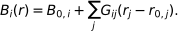
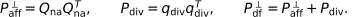
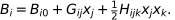
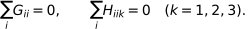

# Timing calibration: research methods

| Summary | Details |
| --- | --- |
| Purpose | Investigate constant Node clock corrections with a fixed Hub. |
| Required inputs | Synthetic nine-spacecraft timing-only observations; pipeline truth and offset records; method-specific weights. |
| Entry points | `hsobs-analyze CONFIG` with `analysis.method: timing-calibrate`; `hsobs-plot-timing-calibrate`. |
| Outputs | All-MC HDF5 with corrections, covariance, objectives, projections/influence and recovery diagnostics. |
| Limitations | Research methodology, not established flight calibration; spatial-model bias and correlated residuals remain. |

`timing-calibrate` analyzes synthetic nine-spacecraft magnetic measurements with
constant timing errors only. It uses the existing magnetic-gradient estimator,
all 382 subsets with 4–9 members by default, and eight timing parameters. The Hub
(`H`) is the fixed reference. Spacecraft and parameter ordering follow the input
IDs, with H omitted from the parameter vector.

## Run

The research configurations named below are local/untracked in the reviewed
working tree and are not supplied by a tracked checkout. These command recipes
require those files and, for generation, external simulation data. 


Regenerate the timing case before analysis: older observations include a random
Hub offset and are rejected. The case now sets
`errors.timing.reference_spacecraft: H`. This optional generation setting zeros
only the named spacecraft's offset before field sampling; it leaves the other
random draws and existing generation defaults unchanged.

```sh
hsobs-generate generation/sim-cali-timing.yaml
hsobs-analyze analysis/sim-cali-timing_timing_calibrate.yaml
hsobs-plot-timing-calibrate outputs/sim-cali-timing_timing_calibrate.h5 \
  --output outputs/sim-cali-timing_timing_calibrate.png --mc-index 0
```

The plotting fallback is `python -m hs_observatory.cli_timing_calibrate` with the
same arguments. Each plotting call also saves a second figure beside the overview,
with `_timeseries` appended to the filename (and the same file extension). It has
four rows and two columns, showing N1–N8 in row order with ideal, measured, and
shifted (corrected) magnetic-field time series for `--mc-index`. It defaults to
Bx; use `--timeseries-component y`, `z`, `magnitude`, or `all` to choose a different
quantity. The `all` view uses component colors and ideal/measured/shifted line
styles. Both plots use the saved product, so no recalculation is needed.

Use `--start-time 100 --stop-time 110` to focus the Node and representative
divergence time series on 100–110 seconds (inclusive). Either bound can be omitted
to use the available beginning or end. The plotted data are restricted to that
interval so vertical limits also adjust to the selected samples. These options
only affect time-series displays; ensemble statistics and calibration results
remain those saved in the product. Empty or invalid time ranges are rejected.

Generation requires the simulation sources configured in the
case; analysis requires only the generated HDF5, and plotting only the analysis
product. Existing observation files are never modified by analysis.

## Fit conventions

An injected offset tau produces `B_measured(t) = B_ideal(t + tau)`. The fitted
correction c is applied as `B_corrected(t) = B_measured(t + c)`, so the reported
recovered injected offset is **-c**. Bias, RMSE, and the 1:1 recovery plot compare
-c with tau. Injected offsets are used for diagnostics, never to build the fit.

By default, one fixed divergence variance per polyhedron is the ideal time-series mean of
`d**2`, without subtracting its mean. `timing_calibrate.sigma_d_floor` defaults to
`1e-12` nT/km and floors the standard deviation. Both raw and floored squared
values are saved. No additional temporal or geometry weights are applied in this mode.

The common prior `sigma_t_s` defaults to the embedded generation uncertainty
(12.5 ms / 3 in this case), and can be explicitly overridden. The augmented
weighted system is solved once with NumPy least squares. Measured-field time
derivatives use centered differences and one-sided endpoints. A shared response
helper builds coefficients through the existing gradient estimator, caching
static relative geometry. Absent spacecraft contribute exactly zero to the
Jacobian. Covariance is computed from an SVD of the augmented design's QR factor,
without residual-variance scaling. It is the covariance implied by the specified
diagonal weighting and prior; overlapping polyhedra are not independent samples.

Corrections use the existing linear time-alignment routine without extrapolation.
Nominal positions remain the analysis geometry. The corrected field is passed
through the gradient estimator responses again; corrected diagnostics are not
just `d + J c`. Unsupported endpoints remain NaN with explicit validity masks.
Actual before/after diagnostics share the same comparison rows. Linear objective
values use the original fit rows and are saved separately. An actual chi-square
increase is recorded and warned about, not hidden or used to modify the fit.
Ideal discrete divergence can bias a zero-error fit; exact zero recovery is only
expected when that discrete divergence is zero or orthogonal to the Jacobian.

## Configuration and output

Use the usual `input`, `analysis`, and `output` mappings, with
`analysis.method: timing-calibrate` and a `timing_calibrate` options mapping.
Optional `polyhedra` is a list of unique spacecraft-ID lists. Alternatively,
`configuration_selection` accepts the existing magnetic-gradient categories.
The two selection modes are mutually exclusive. The `gradient` and `storage`
settings follow magnetic-gradient conventions. All MC realizations are retained.

Optional `polyhedron_filter` further restricts the selected candidates before a
fresh timing fit. For example, use only the 126 tetrahedra:

```yaml
timing_calibrate:
  polyhedron_filter:
    allowed_n: [4]
```

Or require both a spacecraft count and a volumetric-tensor condition-number cut:

```yaml
timing_calibrate:
  polyhedron_filter:
    allowed_n: [6, 7, 8, 9]
    max_condition_number: 100
```

Each entry is optional: absent/null `allowed_n` permits all sizes 4–9, and
absent/null `max_condition_number` applies no condition cut. An absent/null
filter preserves the existing selection. Filters intersect explicit `polyhedra`
or legacy `configuration_selection` candidates, preserving their IDs and order.
The threshold is inclusive (`condition_number <= max_condition_number`). Sizes
must be integers from 4 to 9; the threshold must be finite and positive. Empty
results raise an error.

Conditions come from the existing `geometry_diagnostics()` volumetric tensor.
Static relative geometry uses its first sample; moving geometry uses the median
condition number over all analysis samples, as in the influence diagnostic.
Without a condition cut, singular geometries remain eligible. The gradient
estimator's existing validity rules still apply.

Rerun analysis to apply a filter to an existing product. All fit diagnostics and
normal figures then reflect the fresh fit using the retained configurations;
filtering does not sum or subset an earlier influence decomposition. The JSON
`metadata.polyhedron_filter` attribute records requested controls (including
nulls), `candidate_count`, `retained_count`, and the geometry convention.
`configurations`' `order` attribute records retained IDs; each configuration
stores its existing `number_of_spacecraft` attribute and a scalar
`condition_number` dataset.

The product contains:

- `metadata`: original generation/analysis YAML, version, commit, signs, settings,
  and a `complete` attribute set only after all realizations are written.
- `time/analysis_time`, `spacecraft/id`, `node_id`, `node_indices`, and nominal
  positions, preserving observation ordering.
- `magnetic_field/ideal` (time, spacecraft, component), and `measured` / `corrected`
  (MC, time, spacecraft, component), with `corrected_valid` (MC, time, spacecraft).
  Shared ideal data applies to every realization.
- `configurations/<members-or-category>`: members, N, ideal divergence (time),
  measured/corrected divergence and fit/comparison masks (MC, time), raw/effective
  variance, and normalized RMS before/after (MC).
- `timing`: injected/recovered offsets and applied corrections (MC, 8), and
  covariance (MC, 8, 8), with seconds and squared-seconds units.
- `diagnostics`: actual and linear chi-square, divergence and prior contributions,
  RMS, row counts, unweighted/weighted Jacobian spectra/ranks/condition numbers,
  augmented spectrum/rank, and actual objective-increase flags.
- `mc_summary`: mean, bias, RMSE, population standard deviation, fractional RMS
  reduction `(before-after)/before`, its 25th/50th/75th percentiles, and full
  chi-square distributions. Fractional reduction is NaN for a zero baseline.

Invalid gradient rows follow the existing estimator's pseudoinverse settings.
No valid fit/comparison rows is an error. Rank-deficient data Jacobians have
infinite reported condition numbers, while the prior permits a regularized fit.
The output streams one realization at a time to avoid retaining the complete
ensemble in memory. A failed calculation leaves `metadata.complete = false`.

The diagnostic figure uses Node colors, eight-node recovery/error summaries,
per-MC RMS, a representative weighted spectrum, and up to three polyhedra spread
across the saved configuration order. There is no per-polyhedron panel explosion.

### Optional ideal-divergence reference

Set `timing_calibrate.use_ideal_divergence: true` to fit measured minus ideal
polyhedron divergence. This is enabled in the `null0` analysis configuration;
other configurations retain the absolute-divergence target by default. Weights
still use the ideal mean-square divergence about zero. Both linear and resampled
chi-square diagnostics use the selected target, recorded in `metadata.chi2_target`.
Saved divergence series and normalized divergence RMS remain absolute-divergence
quantities, so existing plots keep their meaning. Rerun analysis to apply the
setting to an existing product.

### Zero-error polyhedron influence diagnostic

`diagnostics.polyhedron_influence: true` adds an ideal-series influence analysis.
It requires `use_ideal_divergence: false`, exactly zero injected offsets, and
measured B equal to ideal B. No weights, geometry selection, solver, or prior are
changed. The diagnostic is shared across the identical MC inputs. Run:

```sh
hsobs-analyze analysis/sim-cali-timing-null0_timing_influence.yaml
python -m hs_observatory.cli_timing_calibrate \
  outputs/sim-cali-timing-null0_timing_influence.h5 \
  --output outputs/sim-cali-timing-null0_timing_influence.png
```

This separate configuration preserves the null0 residual-fit experiment and its
output. It inherits the current null0 prior.

The HDF5 `timing_influence` group saves g, g per polyhedron, H, predicted correction,
correction per polyhedron, the unchanged least-squares reference solution, the fit
mask, ranking, cumulative signed/absolute contributions, and numerical-check
errors/flags. The decomposition uses the full H held fixed: it is additive
influence, not a leave-one-out refit. Contributions are *corrections* c, not
recovered injected offsets -c. H is stored explicitly, but its inverse is never
formed for this calculation: contributions use the SVD of the augmented design's
QR factor. The truncation threshold matches the existing solver. Failed sum or
solver-agreement checks raise an error instead of silently saving bad diagnostics.

Configuration membership and N are linked through the saved polyhedron IDs. Each
configuration gains `influence_geometry` with R, L, cond(R), and (for N>4) the ideal
affine RMS residual over time. Static geometry is stored once. L is the existing
`2*sqrt(max eigenvalue(R))`, and affine residual is the existing vector RMS about
the affine fit. Ranking and bins use median L/condition over time and the temporal
RMS of affine residual. We retain sigma_d from the actual floored weights.

`hsobs-analyze` writes the HDF5 product; figures are generated by the separate
plotting command above. No extra histogram flag is needed. Existing influence
products already contain the condition numbers, so generating the histogram
does not require rerunning analysis.

Plotting automatically adds four figures and a top-ten-per-Node CSV:

- `_influence_condition_numbers`: histogram of volumetric-tensor cond(R), with
  30 logarithmically spaced bins and a logarithmic horizontal axis. Each retained
  polyhedron contributes one value: the first sample for static relative geometry,
  or the median over analysis time for moving geometry. This includes all 382
  polyhedra when all sizes 4–9 are selected, or only those retained by the selection
  and `polyhedron_filter`. The title reports the retained count; nonfinite or
  nonpositive values are excluded from the bars and counted in an annotation.
- `_influence_heatmaps`: signed g and timing contributions (ms), ordered by N;
  symmetric log colors make small signed contributions visible.
- `_influence_cumulative`: signed and absolute cumulative sums, ranked by |c|.
- `_influence_aggregates`: signed sums and sums of magnitudes, grouped by N and
  bins of L, cond(R), and affine residual.
- `_influence_top.csv`: ranked members, N, L, cond(R), sigma_d, affine residual,
  signed g, signed c, and |c|.

The contribution aggregates use saved quartile edges over finite per-polyhedron summaries;
duplicate edges collapse. Bins are left-inclusive, right-exclusive except the
last finite bin. Nonfinite values (and N=4 affine residuals, which are not
applicable) have their own bin, so sums retain all contributions. Absolute sums
are sums of |c_P|, not the absolute value of signed bin totals. These diagnostics
always use the full fit interval; plotting time-window arguments only crop the
existing time-series displays.

To plot the existing products for all polyhedra and each spacecraft-count subset:

```sh
for subset in all n4 n5 n6 n7 n8 n9; do
    python -m hs_observatory.cli_timing_calibrate \
        "outputs/sim-cali-${subset}_timing_influence.h5" \
        --output "outputs/sim-cali-${subset}_timing.png"
done
```

The histograms are saved as
`outputs/sim-cali-<subset>_timing_influence_condition_numbers.png`, alongside the
other diagnostic figures. A script containing only `hsobs-analyze` commands must
also call the plotting command to produce these images.

### All-nine affine projection methods

`timing_calibrate.calibration_method` selects `polyhedron` (the unchanged default),
`all_nine_divergence`, `all_nine_df_affine`, or
[`all_nine_df_quadratic`](#exact-divergence-free-quadratic-projection).
The two affine projection methods use all
nine spacecraft directly, without the 382 overlapping polyhedron residuals.
They share the existing augmented least-squares solver, MC streaming, Hub clock
reference, interpolation, timing covariance, and bias/RMSE summaries.

```yaml
timing_calibrate:
  calibration_method: all_nine_df_affine  # or all_nine_divergence
  sigma_t_s: 0.0125                      # seconds
  sigma_B_nT: 0.1                        # required; illustrative residual scale
```

Use the **same** `sigma_B_nT` for both projection methods. This is a common scale
for magnetic residual components, not a scale estimated from synthetic truth.
There is no measurement-covariance whitening in the existing timing path; scalar
whitening is `y / sigma_B_nT`. It leaves the geometric subspaces unchanged. These
methods reject `use_ideal_divergence: true`, polyhedron influence diagnostics, and
polyhedron selection/filter controls. Ideal B is saved only for diagnostics and
never supplies a target or weight to either fit.

With spacecraft-major component ordering, collect the field into `y(t)` of length
27. Center positions at the nine-spacecraft barycenter using the magnetic-gradient
geometry conventions. The affine model is



<details>
<summary>Equation source (TeX)</summary>

```latex
B_i(r)=B_{0,i}+\sum_j G_{ij}(r_j-r_{0,j}).
```

</details>

Its unconstrained design `M_aff` has 12 columns (three intercepts and nine gradient
entries). Restricting the parameter vector to the null space of
`G_xx + G_yy + G_zz` gives the 11-column `M_df`. A common spatial scale improves
conditioning without changing either column space or the trace constraint.
SVD supplies orthonormal residual bases `Q_na` (27 × 15) and `q_div` (27 × 1):



<details>
<summary>Equation source (TeX)</summary>

```latex
P_{\rm aff}^{\perp}=Q_{\rm na}Q_{\rm na}^{T},\qquad
 P_{\rm div}=q_{\rm div}q_{\rm div}^{T},\qquad
 P_{\rm df}^{\perp}=P_{\rm aff}^{\perp}+P_{\rm div}.
```

</details>

The divergence direction is the part of the affine column space orthogonal to
the divergence-free affine space. The implementation checks design ranks 12 and
11, divergence rank one, and residual-basis orthogonality. Degenerate geometries
raise an error rather than silently changing residual dimensions. Static relative
geometry is factored once; changing geometry is factored at each analysis time.
No explicit pseudoinverse or normal-matrix inverse is formed.

Set `Q = q_div` for `all_nine_divergence` and
`Q = [Q_na, q_div]` for `all_nine_df_affine`. Their common objective is

![Equation: \chi^2(c)=\sum_t\frac{\|Q(t)^T[y(t)+D(t)c]\|^2}{\sigma_B^2} +\frac{\|c\|^2}{\sigma_t^2},\qquad c_H=0.](../assets/equations/display-e5f19af99fb7.svg)

<details>
<summary>Equation source (TeX)</summary>

```latex
\chi^2(c)=\sum_t\frac{\|Q(t)^T[y(t)+D(t)c]\|^2}{\sigma_B^2}
           +\frac{\|c\|^2}{\sigma_t^2},\qquad c_H=0.
```

</details>

Residual coordinates have exactly the same power as the 27-component projected
vectors. Thus the full method has 16 residual dimensions, including 15 non-affine
dimensions and one divergence dimension. `D` uses measured-field centered time
derivatives with one-sided endpoints, as in the existing method. Corrections
sample `B_measured(t+c)`; recovered injected offsets remain **−c**.

After the single linear solve, the existing interpolation routine resamples the
measured fields without extrapolation. Actual before/after objectives use the
same finite time samples after correction; linear objectives and covariance use
the original fit rows. The nominal geometry at each common time is used for both
evaluations, consistent with the existing calibration. First-order approximation
and interpolation errors can prevent exact recovery or increase the actual
objective even when the linear objective improves.

Projection products add:

- `projection`: orthonormal bases, design singular values, rank metadata, and
  `static_geometry`. The leading geometry dimension is 1 or the time count.
- `projection/ideal_{non_affine,divergence}_residual`: diagnostic coordinates in nT.
- `projection/{non_affine,divergence}_residual_{before,after}`: per-MC coordinates
  in nT, with shapes `(MC, time, 15)` and `(MC, time, 1)`.
- `projection/fit_valid` and `comparison_valid`: fit-row and common-time masks.
- `diagnostics/{non_affine,divergence,data}_chi2_{before,after}`: actual residual
  powers divided by `sigma_B_nT²`. The full method's data term is the sum of the
  two components; divergence-only excludes the non-affine component from its fit.
- `diagnostics/linear_data_chi2_{before,after}` and `normalized_residual_rms_*`:
  the linear data term and actual RMS per fitted residual coordinate.
- `timing/recovery_error_s`: recovered minus injected offsets, also now available
  for polyhedron products. Existing field, correction, recovered-offset,
  covariance, Jacobian-spectrum, total-objective, and MC-summary outputs remain.

The covariance is the shared solver's prior-regularized covariance implied by
these weights. It does not account for affine-model error or temporal correlations.

### Comparing calibration methods

Matched example configurations use `outputs/sim-cali-len01.h5` and the same timing
prior. Adjust their common source and all three projection residual scales together
for another experiment:

```sh
for method in polyhedron divergence df-affine df-quadratic; do
    hsobs-analyze "analysis/sim-cali-compare-${method}.yaml"
done
python -m hs_observatory.cli_timing_calibrate \
  outputs/sim-cali-compare-df-quadratic.h5 \
  --output outputs/sim-cali-compare-df-quadratic.png \
  --compare-products outputs/sim-cali-compare-polyhedron.h5 \
                     outputs/sim-cali-compare-divergence.h5 \
                     outputs/sim-cali-compare-df-affine.h5
```

The normal plotting command automatically selects projection diagnostics for new
products: recovery/error, actual objective, timing Jacobian spectrum, separate
non-affine/divergence powers, and residual norms over time. The existing Node B
series plot is also generated. `--compare-products` adds `_comparison.png`, showing
per-Node bias/RMSE, RMS recovered offsets per realization, and median data-only
weighted Jacobian spectra. It verifies identical time arrays, spacecraft ordering,
positions, injected offsets, ideal fields, measured MC inputs, and timing priors;
the projection products must also have equal `sigma_B_nT`.

Raw objective magnitudes are not comparable between the polyhedron and projection
methods: the former keeps its original ideal-divergence weights. Spectrum
magnitudes likewise depend on those weights. Before/after objective comparisons
within each product exclude the same invalid endpoints, but endpoint masks can
differ between methods. Timing recovery compares the same complete input interval.

### Exact divergence-free quadratic projection

The fourth method, `all_nine_df_quadratic`, extends the same projection calibration
path to an exact divergence-free quadratic polynomial. It introduces no quadratic
coefficient regularization. The timing prior is unchanged.

```yaml
timing_calibrate:
  calibration_method: all_nine_df_quadratic
  sigma_t_s: 0.0125
  sigma_B_nT: 0.1
  quadratic_condition_number_max: 1.0e10  # default; reject larger design conditions
```

The matched example is `analysis/sim-cali-compare-df-quadratic.yaml`. As for the
affine methods, `sigma_B_nT` is required, and ideal-reference objectives and
polyhedron selection/influence options are prohibited. Use identical magnetic
normalization for all three projection methods; the legacy polyhedron method
retains its original weights.

Center positions on the observatory barycenter and define
`x = (r - r_bar) / L`, with the repository length
`L = 2 sqrt(max eigenvalue(R))`. The unconstrained coefficient vector has 30 entries:
three B0 entries, nine G entries, and six symmetric H entries per field component.
H ordering is `xx, xy, xz, yy, yz, zz`. Its six quadratic design columns are
`x²/2, xy, xz, y²/2, yz, z²/2`, respecting the factor of one-half in



<details>
<summary>Equation source (TeX)</summary>

```latex
B_i = B_{i0} + G_{ij}x_j + \tfrac12 H_{ijk}x_jx_k.
```

</details>

Four independent linear constraints impose



<details>
<summary>Equation source (TeX)</summary>

```latex
\sum_i G_{ii}=0,\qquad \sum_i H_{iik}=0\quad(k=1,2,3).
```

</details>

An orthonormal null-space basis of these constraints maps 26 free parameters into
the 30 coefficients. Multiplying the sampled unconstrained design by this basis
gives `M_quad` of shape 27 × 26. Common coordinate scaling preserves all four zero
constraints. The reported condition number refers to this scaled design and its
orthonormal constrained parameter basis.

For rank 26, a full SVD supplies the single orthogonal residual column `q`:
`q.T @ M_quad = 0` and `q.T @ q = 1`. The implementation verifies both identities
and evaluates `q.T @ y` directly; it does not construct `q @ q.T`. Design rank uses
`eps * 27 * largest_singular_value`. Rank loss or a condition number exceeding
`quadratic_condition_number_max` raises an error reporting the geometry sample,
effective rank, condition number, and threshold. Static relative geometry is
factored once using the existing geometry convention. For changing geometry,
every sample is checked. Zero observatory extent is also rejected.

The objective is

![Equation: \chi^2(c)=\sum_t\frac{[q(t)^T(y(t)+D(t)c)]^2}{\sigma_B^2} +\sum_\alpha\frac{c_\alpha^2}{\sigma_t^2},\qquad c_H=0.](../assets/equations/display-e8d5d50f3641.svg)

<details>
<summary>Equation source (TeX)</summary>

```latex
\chi^2(c)=\sum_t\frac{[q(t)^T(y(t)+D(t)c)]^2}{\sigma_B^2}
           +\sum_\alpha\frac{c_\alpha^2}{\sigma_t^2},\qquad c_H=0.
```

</details>

The existing augmented least-squares solver estimates eight Node corrections;
recovered offsets remain `-c`. Only measured fields determine the data term and
its time derivatives. The shared interpolation independently recomputes corrected
quadratic residuals at nominal common-time geometry. Before/after actual powers
use the same surviving samples, as in the affine implementation.

Quadratic products use the existing timing, magnetic-field, MC-summary, and
Jacobian/covariance groups. Their `projection` group contains:

- `quadratic_basis`: `(geometry_sample, 27, 1)` unit residual direction.
- `quadratic_singular_values`: `(geometry_sample, 26)` scaled design spectrum.
- `quadratic_condition_number` and `quadratic_rank`: per-geometry diagnostics.
- `ideal_quadratic_residual`: diagnostic truth residual, `(time, 1)`, in nT.
- `quadratic_residual_before` and `quadratic_residual_after`: `(MC, time, 1)`, in nT.
- `fit_valid` and `comparison_valid`: the existing fit-row/common-time masks.

`diagnostics/quadratic_chi2_{before,after}` equals the actual `data_chi2_*` term;
`chi2_*` also includes the timing prior. The usual linear-objective diagnostics,
normalized residual RMS, data-only timing spectra/ranks, and recovery errors are
retained. The standard diagnostic plot adds the quadratic design spectrum and
condition number alongside quadratic residual powers and time series. The existing
`--compare-products` option accepts all four methods without another flag.

See [the quadratic investigation](../research-notes/timing-investigations.md#quadratic-projection-experiment) for validation
and the zero-injected-error nonlinear-field results.


## Instrument-noise divergence normalization

The default remains `divergence_normalization: ideal_divergence`. For the
polyhedron method, select the flight-accessible weighting as follows (paths are
relative to the analysis YAML):

```yaml
timing_calibrate:
  divergence_normalization: instrument_noise
  instrument_noise:
    spectrum_file: ../configs/helioswarm_mag_scm_noise.yaml
    interpretation: per_component
    below_range: flat
    above_range: error
    variance_floor_nT2_per_km2: 0.0
    processing:
      sampling: ideal_antialias
      averaging_duration_s: 0.0
```

The editable spectrum is an approximate digitization of the anticipated merged
MAG+SCM noise floor, **not final instrument specifications**. The working
assumption is a per-component ASD, pending MAG-team confirmation. Setting
`interpretation: vector_total` treats its square as the total power in three
isotropic components and divides component PSD by three.

ASD is interpolated in log-log space, then squared to obtain one-sided PSD in
nT²/Hz. Integration of `PSD * |H|² df` gives per-component variance in nT²;
its square root is `sigma_B_nT`. Uniform input cadence sets Nyquist. The lower
limit is DC, never inverse record duration. Both range policies default to
`error`; `flat` explicitly extends the endpoint ASD. In particular, the example
assumes constant ASD below 0.0007 Hz. It does not claim a measured DC noise floor.
Above 20 Hz, either extend the model, explicitly choose `above_range: flat`, or
supply a response that eliminates the unsupported frequencies.

`sampling: ideal_antialias` explicitly declares that input samples have no
aliased out-of-band power. This implementation does not infer the instrument
anti-alias response. Nonuniform sampling is rejected. An optional
`averaging_duration_s` models continuous boxcar averaging with
`|H|² = sinc(f * duration)²`. Optional `transfer_power: [[f_Hz, power], ...]`
multiplies that response, interpolating power linearly; it must cover DC through
Nyquist with nonnegative power. These describe processing **already applied to
the input**, and require `applied_to_input: true` when provided. No filter is
applied by the noise calculation. Discrete averaging or other filters should
supply their actual squared response through `transfer_power`. A high-pass
response permits unsupported low frequencies only where its power is exactly
zero; attenuation alone does not remove the need for a noise model.

For each retained polyhedron, the existing volumetric tensor supplies
`sigma_d² = sigma_B² * Tr(R^-1) / N` in (nT/km)². Time-dependent geometry produces
one variance per time and polyhedron. Singular geometry has infinite variance
and is excluded from fit rows. The optional explicit variance floor is applied
with `max(raw_variance, floor)` and is never inferred from synthetic divergence.
This assumes independent spacecraft noise and isotropic, uncorrelated components.
Temporal correlations introduced by filtering and correlations among overlapping
polyhedra are not added to the least-squares covariance model.

The least-squares solver is unchanged; time-dependent weights are adapted into
its existing row format. Existing selection, geometry filters, MC realizations,
ideal-reference option, and plots remain available. Projection calibration
methods retain their existing normalization. The synthetic analysis pipeline
still requires truth for diagnostics and weight comparison; instrument weights
and the absolute-divergence fit do not use its values. Selecting
`use_ideal_divergence: true` remains a truth-assisted experiment.

Products save the original spectrum YAML, component ASD and PSD, integration
nodes and quadrature weights, integration limits, response, cadence, range
policies, processing assumptions, sigma_B, and per-polyhedron raw/floored
variance and sigma_d. Objective fractions before/after are in `diagnostics`;
existing per-Node bias and RMSE remain in `mc_summary`. The plotting CLI adds
`_noise_weights`, showing the implemented spectrum, instrument versus ideal
weights (median inverse variance for moving geometry), and objective fractions.
`--compare-products` also compares timing recovery with the existing method.
## Historical experiments

The [timing investigations](../research-notes/timing-investigations.md) preserve
separate affine and quadratic setups/results and the provisional noise-normalization
experiment. They are historical evidence, not newly reproduced results.
