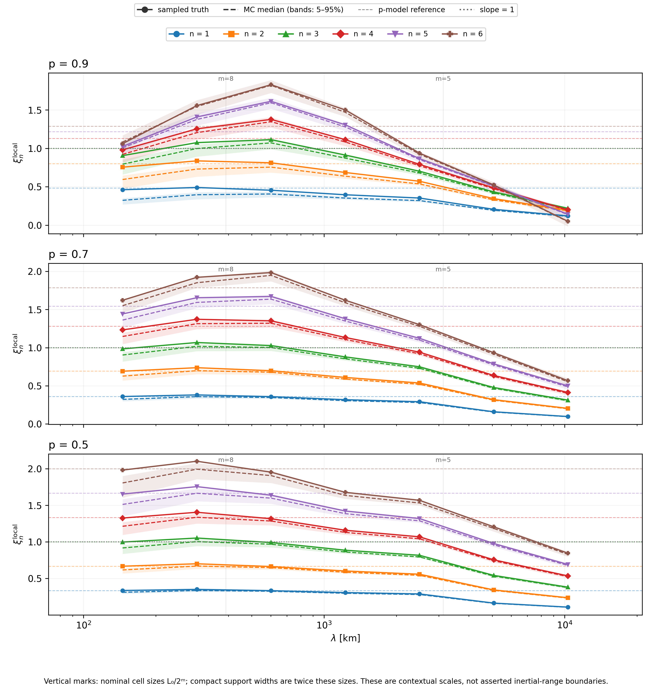
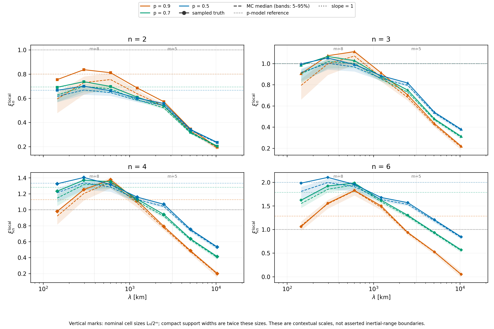

# Intermittency recovery: scaling and spatial sampling

This ongoing investigation asks whether the scale-dependent structure-function
exponents recovered from virtual HelioSwarm observations reflect the Malara field
itself, spacecraft sampling, or subsequent processing. A global fit agreeing
with p-model theory does not establish a scale-invariant interval.

The [method reference](../reference/statistical-methods.md#structure_function)
documents the implemented calculations, CLI controls and data contracts. This
page tracks findings, validation status, locally generated plots and next steps.
The snapshots below come from existing workspace products; the underlying
production JSON/HDF5 files are generated artifacts and are not distributed with
these docs. A versioned input/commit record is still needed for publication.

## Status and input products

| Stage | Status | Evidence and limits |
| --- | --- | --- |
| Global fit-range sweep | Completed on saved virtual-HS results | All nine bins and progressive trimming from either end; no observation regeneration. |
| Local logarithmic slopes | Completed on saved virtual-HS results | Both estimators implemented; per-realization MC propagation; nine bins limit plateau resolution. |
| Direct raw-field 3D sampler | Implemented and smoke-tested | Production field, 16 pairs at five separations per p; functionality validation only. |
| Direct 3D pilot and convergence | Not yet run in this investigation | Requires explicit execution and adequate high-order sampling before a scientific comparison. |

The saved virtual-HS structure-function inputs are
`outputs/malara-prod-{400,401,402}_sf_publication.json`, corresponding to
`p=0.9, 0.7, 0.5`. Each contains orders 1–6, nine separation centers from about
71 to 21,029 km, one sampled-truth curve and 50 individual observation-MC curves.
The saved range named `total` is **300–8,000 km**, not the full available range.

The matching generation YAMLs specify a periodic 100,000 km cubic domain,
injection index 2, maximum scale index 14, spectral exponent 1/3, field seed
12345 and realization 1. The raw evaluator's epsilon exponent defaults to 1/3.
These parameters are read from the generation configurations by the direct
analysis; they are not scientific defaults for arbitrary datasets.

## Global fit-range sensitivity

Including large separations lowers global fitted exponents as the structure
functions flatten. The sweep compares a true full-range refit with progressive
removal of the smallest or largest bins, stopping at three retained bins.

```bash
.venv/bin/python scripts/structure_function_fit_sweep.py
```

The current nine-bin inputs produce 13 figures and 234 CSV rows in
`outputs/malara-prod-combined_sf_fit_sweep/`: `all.png`,
`drop_large_1.png` through `drop_large_6.png`, `drop_small_1.png` through
`drop_small_6.png`, and `fits.csv`. Every plot retains the original moment points
and shades the fitted interval. The CSV records exact bounds, exponents, fit
counts and MC percentiles.

This range dependence motivates local derivatives: a narrower fit may recover
theoretical values because of a plateau, or because a curved function crosses
the analytic slope.

## Local-slope findings

Local slopes estimate `d ln(S_n) / d ln(lambda)`. The default three-point
regression uses actual bin centers and has undefined endpoints; the adjacent
estimator uses geometric midpoints. MC slopes are calculated independently for
each of the 50 realizations before taking the median and 5th–95th percentiles.
Neither estimator bridges invalid-data gaps.

```bash
scripts/plot_malara_prod_combined_sf_publication.sh \
  --local-slopes --show-cascade-scales
```

Add `--local-slope-method adjacent` to inspect the alternative estimator. The
default files live directly in `outputs/`:

- `malara-prod-combined_sf_publication_local_slopes.png` and `.pdf`: six orders,
  one row per p.
- `malara-prod-combined_sf_publication_local_slopes_focused.png` and `.pdf`:
  orders 2, 3, 4 and 6, comparing the three p-values.
- `malara-prod-combined_sf_publication_local_slopes.h5`: slopes, individual MC
  results, percentiles, validity masks and provenance.



*Solid curves show ideal sampled truth; dashed curves and bands show observation
MC medians and 5th–95th percentiles. Horizontal lines show theory. Vertical
marks indicate nominal dyadic cell sizes; compact support widths are twice
those sizes, and these marks do not assert inertial-range boundaries.*



*The focused figure exposes scale dependence for orders 2, 3, 4 and 6 while
retaining the existing orange/green/blue p-value colors.*

The slopes show large-scale flattening. For `p=0.5`, the first three interior
sampled-truth order-6 slopes are approximately **1.98, 2.10 and 1.95**, close to
the theoretical value 2. For `p=0.9`, they are approximately **1.06, 1.56 and
1.83**, compared with theory at 1.286, followed by a decline at larger scales.
The p=0.9 high-order curves therefore exhibit pronounced curvature rather than
an established broad plateau.

Nine source bins yield only seven overlapping three-point estimates. They can
reveal curvature but give limited evidence for an extended scale-invariant
region. Adjacent slope locations are not additional independent measurements
of the field, and neighboring three-point estimates share input bins.

## Direct 3D validation

The new registered `spatial_structure_function` analysis samples uniform spatial
positions and isotropic separation directions, evaluates raw Malara vector
increments at exact separations, and accumulates all six moments together.
It bypasses spacecraft trajectories, time-series generation, instruments,
observation errors and Elsasser conversion.

The implementation preserves the production field's normalization, seed and
realization, reuses shared moment/global-fit/local-slope/theory routines, and
bounds processing and caches by chunks. The per-separation random streams are
shared across p-values and support deterministic coordinate prefixes as sample
counts increase. Cached refitting and plotting do not evaluate the field.

Only this small production-field smoke calculation has been run:

```bash
.venv/bin/hsobs-analyze-spatial-structure-function \
  configs/example_spatial_structure_function.yaml \
  --n-pairs 16 --lambda-centers-km 50 200 500 1000 20000 \
  --backend cached --smoke --output-prefix outputs/direct-spatial-sf-smoke
```

It generated `outputs/direct-spatial-sf-smoke.h5` and PNG/PDF figures with suffixes
`_structure_functions`, `_local_slopes` and `_comparison`. Cached regeneration
also produced the `outputs/direct-spatial-sf-smoke-refit` series, preserving the
sampled moments. These products verify counts, checkpoint accounting, field
provenance, serialization and plotting. **Sixteen pairs, with two pairs per
batch, support no scientific conclusion about a plateau or intrinsic curvature.**

The default direct candidate fit is 200–1,000 km. The saved HS grid has only two
centers there, so its fit is unavailable under the retained three-point minimum.
The additional 100–1,300 km comparison window has four HS centers. Fits use each
dataset's actual points, without interpolation or window adjustment to match
theory. These are diagnostic windows, not asserted inertial-range boundaries.

## Next experiments and interpretation checks

1. Explicitly run the 2,000-pair, 25-separation pilot:

   ```bash
   .venv/bin/hsobs-analyze-spatial-structure-function \
     configs/example_spatial_structure_function.yaml
   ```

   This performs 100,000 point evaluations per p and may be expensive. It has
   not been launched automatically.

2. Inspect full-sample and batch moments, local slopes and cumulative
   25/50/75/100% checkpoints. Batch SD bands measure spatial sampling variability
   within one deterministic field, not uncertainty across independent field
   realizations. Overlapping eddy supports also limit independence assumptions.

3. Increase to 5,000 pairs explicitly and check high-order convergence before
   considering 50,000 or more. Coordinates extend the same deterministic prefix,
   but field evaluations replay the prefix rather than resume a previous run.

4. Compare direct and ideal-HS fitted exponents on identical bounds; optionally
   sample the saved HS centers using `--centers-from-hs`. Raw q and processed HS
   Elsasser fields differ in preprocessing, so a discrepancy alone does not
   identify spacecraft sampling as its sole cause.

5. Regenerate derivatives, fit windows and plots from cached moments:

   ```bash
   .venv/bin/hsobs-plot-spatial-structure-function outputs/direct-spatial-sf.h5 \
     --fit-lambda-range 200 1000 --fit-window comparison 100 1300 \
     --show-cascade-scales --output-prefix outputs/direct-spatial-sf-refit
   ```

The open scientific question remains whether adequately converged direct 3D
statistics show the same slope maximum and large-scale decline, and whether any
near-theoretical region persists across multiple resolved scales. A theory
crossing or a successful smoke test does not settle that question.
