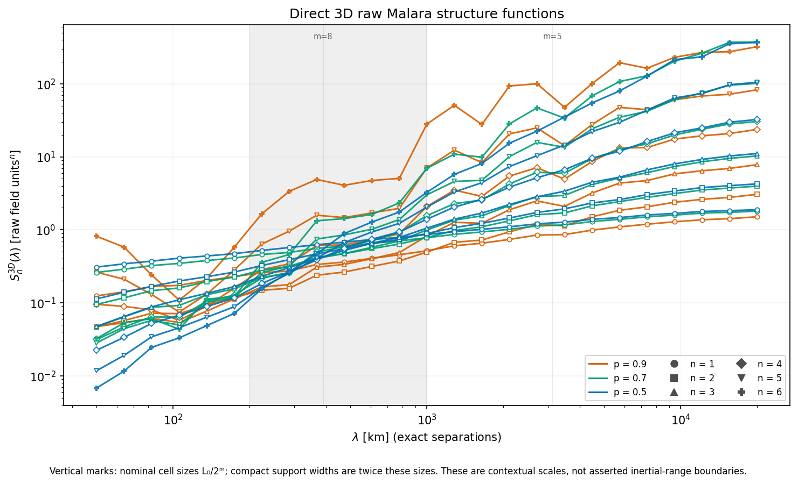
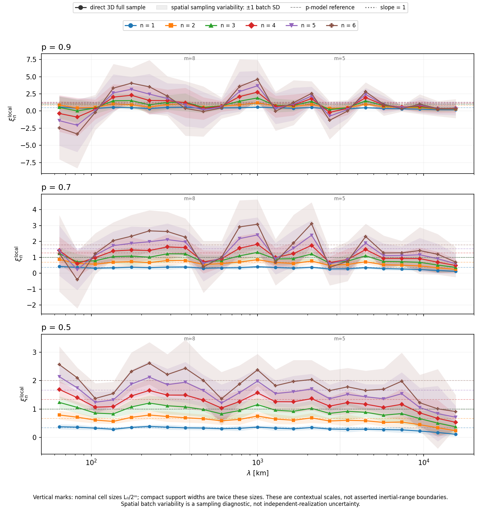
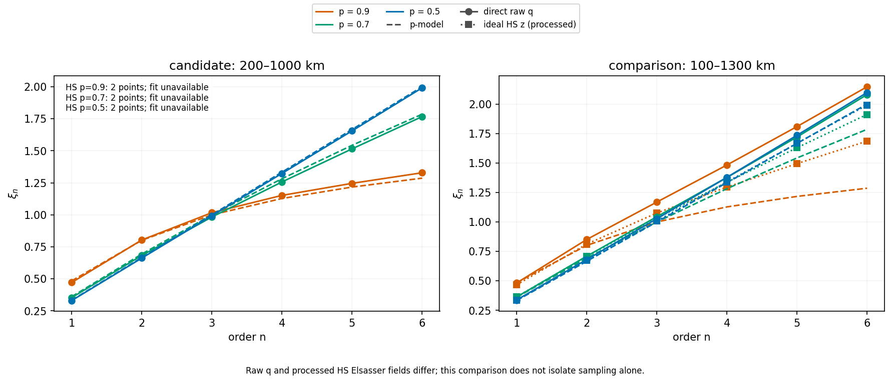
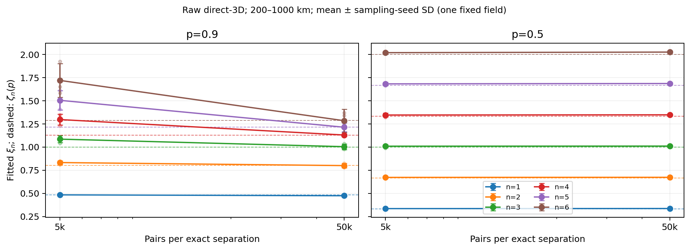

# Intermittency recovery: scaling and spatial sampling

This ongoing investigation asks whether the scale-dependent structure-function
exponents recovered from virtual HelioSwarm observations reflect the Malara field
itself, spacecraft sampling, or subsequent processing. A global fit agreeing
with p-model theory does not establish a scale-invariant interval.

The [method reference](../reference/statistical-methods.md#structure_function)
documents the implemented calculations, CLI controls and data contracts. This
page tracks findings, validation status, locally generated plots and next steps.
The snapshots below come from existing workspace products; the underlying
production JSON/HDF5 files are generated artifacts and are not distributed with
these docs. A versioned input/commit record is still needed for publication.

## Status and input products

| Stage | Status | Evidence and limits |
| --- | --- | --- |
| Global fit-range sweep | Completed on saved virtual-HS results | All nine bins and progressive trimming from either end; no observation regeneration. |
| Local logarithmic slopes | Completed on saved virtual-HS results | Both estimators implemented; per-realization MC propagation; nine bins limit plateau resolution. |
| Direct raw-field 3D sampler | Implemented and validated for basic arithmetic | Uniform positions and isotropic directions; raw Malara increments at exact separations. |
| Direct 3D pilots | Completed | 2k and 5k pairs/separation, 25 scales, three p values; high-order estimates were not converged. |
| Geometry-stratified virtual-HS estimator | Implemented and tested | Exact eligible-pair census and uniform sampling without replacement within bins; pair-sampling convergence is not independent-event convergence. |
| Updated 40X publication analysis | Completed | 26-bin piecewise scheme, 150–1200 km primary fit, 50 measurement-error MC members; p=0.9 departures persist. |
| Uniform-bin and boundary-shift controls | Completed, truth only | The p=0.9 local-slope feature survives uniform log bins, a half-bin shift, and independent pair-selection seeds. |
| Truth-only observation-duration/trajectory studies | Completed for 500/502 and 500a/502a | 300–1500 s at fixed realizations; changing trajectory direction changes p=0.9 structure-function shapes and fitted exponents. |
| Study A extreme-increment diagnostics | Completed at 500k selected pairs/bin | p=0.9 sixth-order moments concentrate in rare increments and a narrow pair-midpoint interval; statistical independence not established. |
| Direct 3D multi-seed convergence campaign | Completed to 50k pairs/separation | Three spatial seeds for p=0.9 and 0.5 on seven fixed 200–1000 km centers; exponent means approach theory, but p=0.9 S6 remains unstable. |
| Direct 3D 500k extension | Planned/requested | p=0.9, one spatial seed, same seven centers; not yet a completed result. |

The saved virtual-HS structure-function inputs are
`outputs/malara-prod-{400,401,402}_sf_publication.json`, corresponding to
`p=0.9, 0.7, 0.5`. Each contains orders 1–6, nine separation centers from about
71 to 21,029 km, one sampled-truth curve and 50 individual observation-MC curves.
The saved range named `total` is **300–8,000 km**, not the full available range.

The matching generation YAMLs specify a periodic 100,000 km cubic domain,
injection index 2, maximum scale index 14, spectral exponent 1/3, field seed
12345 and realization 1. The raw evaluator's epsilon exponent defaults to 1/3.
These parameters are read from the generation configurations by the direct
analysis; they are not scientific defaults for arbitrary datasets.

## Current interpretation (October 2026)

The analytic p-model reference is

\[
\zeta_n(p)=1-\log_2\!\left[p^{n/3}+(1-p)^{n/3}\right].
\]

**Do not equate three distinct statistics:** the analytic cascade prediction,
full-volume isotropic structure functions of the *finite reconstructed raw field*,
and binned spacecraft-time structure functions of processed ideal Elsasser samples.
The cascade's cell-averaged multiplier/coefficient moments have the intended
scaling when the configured exponents are 1/3, but this does not algebraically
guarantee identical exponents for increments of the superposed curl-derived field.

The present field realization is periodic in a 100,000 km cube and contains
13 included dyadic levels, indices 2–14. Eddies occupy fixed dyadic-lattice
centers with randomized orientations/signs/deformations; their supports are
Cartesian-aligned. Large-scale curvature, finite supports, field superposition,
and finite-realization anisotropy can influence measured vector increments.
For the constant-density shared-q 500a/502a cases, ideal z-plus increments are
proportional to raw-q increments **except** that separate spacecraft full-record
means do not generally cancel for cross-spacecraft pairs.

### Virtual-HelioSwarm sampling results

The revised publication workflow uses geometry-stratified sampling and finer
separation bins. Comparisons of piecewise, uniformly logarithmic, and
half-bin-shifted grids show that the strong p=0.9 local-slope features are **not
solely bin-edge artifacts**. Increasing pair-selection budgets reduces numerical
subsampling variability but does not remove the discrepancy with theory.

Nested truth-only observations at 300, 600, 900, 1200, and 1500 s were evaluated
for p=0.9 and p=0.5. For the first trajectory, p=0.9 fitted sixth-order
exponents were approximately 1.65 at 300–600 s and 2.06–2.09 at 900–1500 s,
versus analytic 1.286. The p=0.5 case approached its analytic sixth-order
exponent of 2. Changing the advection direction to sample substantially more
of the box in y (500a/502a) altered the p=0.9 duration dependence and moved
prominent local-slope features, without reliably recovering analytic scaling.
These are trajectory-dependent, finite-window measurements, **not evidence of a
change in the underlying static field**.

### Study A: high-order contribution concentration

The 1500-s 500a/502a cases were diagnosed at five representative separations
(approximately 309, 472, 721, 957, and 1463 km), with three pair-selection
seeds and 500,000 requested pairs/bin. For p=0.9, the largest 1% of increment
amplitudes contribute **90.8–95.9% of S6**, compared with **27.5–29.4%** for
p=0.5. Contributions to the p=0.9 S6 also concentrate strongly in a short
pair-*midpoint* interval around 500–550 s over several separations, whereas the
p=0.5 contributions are much more distributed. The midpoint assignment does
not prove both endpoints encounter a single physical structure. Nominal pair
count, concentration-based effective count, and independently observed turbulent
events are different quantities. Only one pair budget was saved for Study A;
its budget-convergence plot is therefore not yet a multi-budget test.

## Global fit-range sensitivity

Including large separations lowers global fitted exponents as the structure
functions flatten. The sweep compares a true full-range refit with progressive
removal of the smallest or largest bins, stopping at three retained bins.

```bash
.venv/bin/python scripts/structure_function_fit_sweep.py
```

The current nine-bin inputs produce 13 figures and 234 CSV rows in
`outputs/malara-prod-combined_sf_fit_sweep/`: `all.png`,
`drop_large_1.png` through `drop_large_6.png`, `drop_small_1.png` through
`drop_small_6.png`, and `fits.csv`. Every plot retains the original moment points
and shades the fitted interval. The CSV records exact bounds, exponents, fit
counts and MC percentiles.

This range dependence motivates local derivatives: a narrower fit may recover
theoretical values because of a plateau, or because a curved function crosses
the analytic slope.

## Local-slope findings

Local slopes estimate `d ln(S_n) / d ln(lambda)`. The default three-point
regression uses actual bin centers and has undefined endpoints; the adjacent
estimator uses geometric midpoints. MC slopes are calculated independently for
each of the 50 realizations before taking the median and 5th–95th percentiles.
Neither estimator bridges invalid-data gaps.

```bash
scripts/plot_malara_prod_combined_sf_publication.sh \
  --local-slopes --show-cascade-scales
```

Add `--local-slope-method adjacent` to inspect the alternative estimator. The
default files live directly in `outputs/`:

- `malara-prod-combined_sf_publication_local_slopes.png` and `.pdf`: six orders,
  one row per p.
- `malara-prod-combined_sf_publication_local_slopes_focused.png` and `.pdf`:
  orders 2, 3, 4 and 6, comparing the three p-values.
- `malara-prod-combined_sf_publication_local_slopes.h5`: slopes, individual MC
  results, percentiles, validity masks and provenance.


*Solid curves show ideal sampled truth; dashed curves and bands show observation
MC medians and 5th–95th percentiles. Horizontal lines show theory. Vertical
marks indicate nominal dyadic cell sizes; compact support widths are twice
those sizes, and these marks do not assert inertial-range boundaries.*


*The focused figure exposes scale dependence for orders 2, 3, 4 and 6 while
retaining the existing orange/green/blue p-value colors.*

The slopes show large-scale flattening. For `p=0.5`, the first three interior
sampled-truth order-6 slopes are approximately **1.98, 2.10 and 1.95**, close to
the theoretical value 2. For `p=0.9`, they are approximately **1.06, 1.56 and
1.83**, compared with theory at 1.286, followed by a decline at larger scales.
The p=0.9 high-order curves therefore exhibit pronounced curvature rather than
an established broad plateau.

Nine source bins yield only seven overlapping three-point estimates. They can
reveal curvature but give limited evidence for an extended scale-invariant
region. Adjacent slope locations are not additional independent measurements
of the field, and neighboring three-point estimates share input bins.

## Direct 3D validation

The new registered `spatial_structure_function` analysis samples uniform spatial
positions and isotropic separation directions, evaluates raw Malara vector
increments at exact separations, and accumulates all six moments together.
It bypasses spacecraft trajectories, time-series generation, instruments,
observation errors and Elsasser conversion.

The implementation preserves the production field's normalization, seed and
realization, reuses shared moment/global-fit/local-slope/theory routines, and
bounds processing and caches by chunks. The per-separation random streams are
shared across p-values and support deterministic coordinate prefixes as sample
counts increase. Cached refitting and plotting do not evaluate the field.

The initial functionality check used this small production-field smoke calculation:

```bash
.venv/bin/hsobs-analyze-spatial-structure-function \
  configs/example_spatial_structure_function.yaml \
  --n-pairs 16 --lambda-centers-km 50 200 500 1000 20000 \
  --backend cached --smoke --output-prefix outputs/direct-spatial-sf-smoke
```

It generated `outputs/direct-spatial-sf-smoke.h5` and PNG/PDF figures with suffixes
`_structure_functions`, `_local_slopes` and `_comparison`. Cached regeneration
also produced the `outputs/direct-spatial-sf-smoke-refit` series, preserving the
sampled moments. These products verify counts, checkpoint accounting, field
provenance, serialization and plotting. **Sixteen pairs, with two pairs per
batch, support no scientific conclusion about a plateau or intrinsic curvature.**

The default direct candidate fit is 200–1,000 km. The saved HS grid has only two
centers there, so its fit is unavailable under the retained three-point minimum.
The additional 100–1,300 km comparison window has four HS centers. Fits use each
dataset's actual points, without interpolation or window adjustment to match
theory. These are diagnostic windows, not asserted inertial-range boundaries.

## Direct 3D pilot figures

The 2,000-pair pilot has now been run with:

```bash
.venv/bin/hsobs-analyze-spatial-structure-function \
  configs/example_spatial_structure_function.yaml
```

The example configuration samples 25 separations from 50 to 20,000 km for
`p=0.5, 0.7, 0.9`, with eight batches, seed 12345 and three-point local slopes.
This corresponds to 100,000 point evaluations per p. The saved product is
`outputs/direct-spatial-sf.h5`; the three PNG snapshots below are copied from
its accompanying figures into the documentation assets.



*Orders 1–6 at exact spatial separations, with colors indicating p and markers
indicating order. The shaded interval is the 200–1,000 km candidate fit window.
Vertical marks show nominal cascade cell sizes, not established inertial-range
boundaries.*



*Three-point local slopes of the full-sample moments, compared with p-model
theory. Bands show batch standard deviations from spatial sampling within one
deterministic field; they do not measure uncertainty across field realizations.*



*Global exponents in the 200–1,000 km candidate and 100–1,300 km comparison
windows. Circles show direct raw q, squares show ideal processed HS Elsasser
results and dashed curves show p-model theory. The candidate window has too
few HS centers for a fit. Differences between raw and processed fields prevent
this comparison from isolating spacecraft sampling alone.*

These figures provide the first pilot comparison. High-order convergence and
persistence of any near-theoretical local-slope interval remain open checks.

## Direct 3D convergence: updated evidence

The existing direct sampler measures raw-vector increments of the same
parameter-compatible p=0.9 and p=0.5 Malara realizations as the 500a/502a
observations, at uniformly chosen spatial positions and isotropic directions.
Its earlier 2k and 5k pilots were exploratory: for p=0.9 the sixth-order
200–1000 km exponent changed from 1.328 (2k, one seed) to 1.649 (5k, one seed).
This earlier apparent agreement with theory was **not a convergence result**.

A subsequent campaign used three spatial-sampling seeds, 5k and 50k pairs
**per exact separation**, and seven full-precision centers over 200–1000 km:
223.607, 287.015, 368.403, 472.871, 606.962, 779.078 and 1000 km. The
field seed and realization were unchanged. The values below are mean ± sample
SD across **pair-sampling seeds**, not independent field realizations.

| p | n | Analytic ζ_n | Direct ξ_n (5k) | Direct ξ_n (50k) |
| --- | ---: | ---: | ---: | ---: |
| 0.9 | 3 | 1.000 | 1.085 ± 0.038 | 1.004 ± 0.030 |
| 0.9 | 4 | 1.128 | 1.297 ± 0.060 | 1.130 ± 0.012 |
| 0.9 | 5 | 1.217 | 1.505 ± 0.104 | 1.214 ± 0.047 |
| 0.9 | 6 | 1.286 | 1.720 ± 0.181 | 1.284 ± 0.126 |
| 0.5 | 3 | 1.000 | 1.009 ± 0.017 | 1.010 ± 0.007 |
| 0.5 | 4 | 1.333 | 1.346 ± 0.020 | 1.348 ± 0.008 |
| 0.5 | 5 | 1.667 | 1.682 ± 0.019 | 1.686 ± 0.009 |
| 0.5 | 6 | 2.000 | 2.019 ± 0.015 | 2.025 ± 0.011 |



**Interpretation:** 50k isotropic spatial pairs produce global slopes consistent
with the prescribed p-model and much closer than virtual-HS p=0.9 results.
Nevertheless, individual p=0.9 S6 estimates remain sensitive to rare samples:
at 50k, the maximum early-checkpoint discrepancy across seeds reaches ~55%
at 224 km, ~79% at 287 km, and ~73% at 779 km. The fitted sixth-order
exponent's seed SD is ~0.126. A close mean exponent or high fit R² is **not
proof of sixth-order moment convergence**. The p=0.5 field shows much stronger
moment and exponent stability.

Saved numerical evidence: `outputs/malara_direct3d_convergence/convergence_report.md`
(with separate seed/budget HDF5 products) and
`docs/malara_field_validation_audit.md`. The field-validation audit documents
provenance, sampler behavior, finite-width versus exact-separation differences,
and the raw-q / per-spacecraft-mean caveat. The present campaign does **not**
measure variability across independent Malara realizations.

## Next experiments and interpretation checks

1. **Extend direct p=0.9 sampling to 500k spatial pairs per separation** using
   the same seven full-precision centers and fixed field realization; begin
   with one seed. Track individual S4/S6, saved checkpoints, fitted exponents,
   and local slopes. This job has been requested but is **not yet complete**.
   Add seeds if moment sensitivity warrants them; do not declare convergence
   from one seed or theory agreement alone.

2. If p=0.9 S6 remains unstable, reuse the Study A arithmetic in the direct
   spatial sampler to measure C_n(x), extreme-contribution fractions, and
   spatial (not temporal) localization, without changing the field model.

3. Once full-field estimates are stable, compare direct raw q and ideal-HS
   samples with common field provenance, separation windows, and documented
   exact-center versus finite-bin weights. Explicitly assess cross-spacecraft
   mean subtraction before identifying a trajectory-only effect.

4. Only if stable raw-field spatial exponents systematically depart from the
   analytic reference should we prioritize tests of cascade-coefficient
   statistics, directional anisotropy, spatial subvolumes, and independent
   Malara realizations. Do not tune the fitting interval to force theoretical
   agreement.

The central unresolved question is **how much of the discrepancy in virtual-HS
high-order scaling arises from restricted trajectory/event diversity**, as
opposed to the field's finite-realization statistics or the preprocessing and
separation estimator. The improved direct-3D result supports the trajectory
hypothesis but does not yet establish it uniquely.
